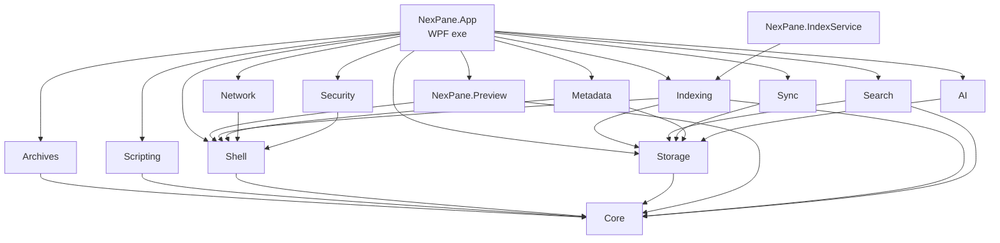
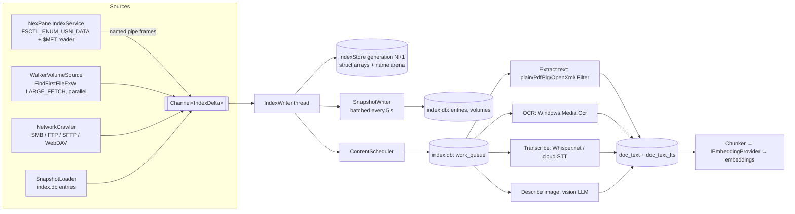
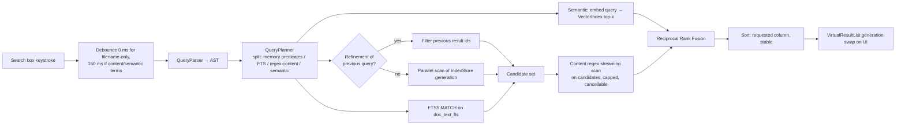
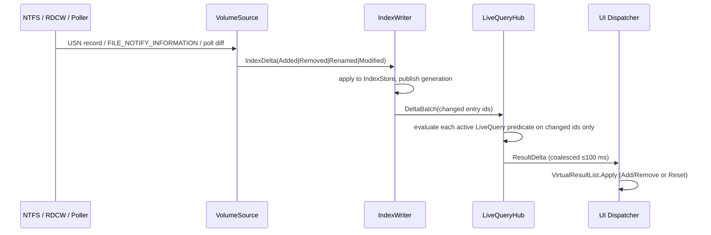
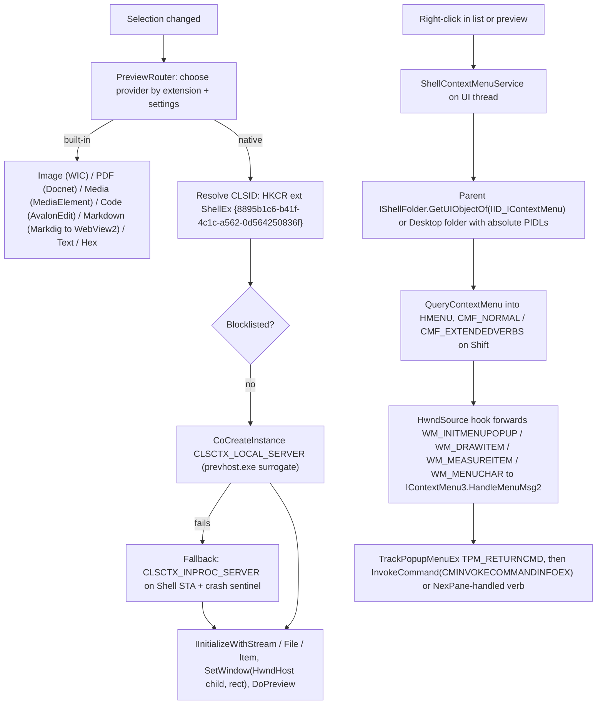

# NexPane — Architecture

> Owner: Subagent 1 (Lead Architect & State Scribe). Status: Phase 1 deliverable, `[READY_FOR_QA]`.
> Last updated: 2026-10-21. This is the binding technical design. Any deviation must be recorded in §19 (Decision Log) with a reason, and reflected in `TODO.md` / `STATE.md`.

## Table of Contents

1. [Product summary](#1-product-summary)
2. [Stack decision and rationale](#2-stack-decision-and-rationale)
3. [Solution and directory layout](#3-solution-and-directory-layout)
4. [Module boundaries and dependency direction](#4-module-boundaries-and-dependency-direction)
5. [Threading model](#5-threading-model)
6. [Data flows (Mermaid)](#6-data-flows)
7. [Indexing and search design](#7-indexing-and-search-design)
8. [Query language specification](#8-query-language-specification)
9. [Persistence: SQLite schema](#9-persistence-sqlite-schema)
10. [Contracts: key C# interfaces](#10-contracts-key-c-interfaces)
11. [Shell integration (COM / Win32)](#11-shell-integration-com--win32)
12. [Power tools design](#12-power-tools-design)
13. [AI subsystem](#13-ai-subsystem)
14. [UI architecture](#14-ui-architecture)
15. [NuGet packages and licenses](#15-nuget-packages-and-licenses)
16. [Security model](#16-security-model)
17. [Performance budgets](#17-performance-budgets)
18. [Testing strategy](#18-testing-strategy)
19. [Branding, build, packaging, installer](#19-branding-build-packaging-installer)
20. [Risks and honest limitations](#20-risks-and-honest-limitations)
21. [Decision log](#21-decision-log)
22. [Requirements traceability matrix](#22-requirements-traceability-matrix)

---

## 1. Product summary

NexPane is an unpackaged, x64, Windows 10 1809+ / Windows 11 desktop file manager with:

- **Search & indexing** (scope A): in-memory filename index with search-as-you-type, inline query operators, regex, visual filter builder, NTFS USN/MFT fast enumeration via an elevated helper service, fallback walker + watchers, network crawler, live result updates, saved search categories.
- **Workspace & power tools** (scope B): dual pane, unlimited tabs, session restore, preview pane, authentic native Shell context menu, archives as virtual folders, folder compare/sync, batch renamer, metadata editor, embedded JavaScript scripting, network VFS (SMB, FTP/FTPS, SFTP, WebDAV), customizable toolbars/shortcuts/docking/themes.
- **AI** (scope C): provider abstraction for Azure AI Foundry, Google Gemini, Anthropic Claude, OpenAI, AWS Bedrock, OpenAI-compatible local servers (LM Studio, Ollama, custom); semantic search, natural-language-to-query, summarize/translate/prepare-reply, transcription with timestamped export, OCR and visual descriptions indexed into search.
- **Branding** (scope D) and **installer** (scope E).

---

## 2. Stack decision and rationale

**Locked:** C# 14 on **.NET 10 (LTS)** + **WPF**, x64 only, unpackaged, Inno Setup 6 installer, Git.

| Requirement | Why .NET 10 + WPF fits |
|---|---|
| Real native Shell context menu | `IShellFolder::GetUIObjectOf` → `IContextMenu` / `IContextMenu2` / `IContextMenu3`, `TrackPopupMenuEx` on the UI HWND, message forwarding through `HwndSource.AddHook`. Built-in COM interop + CsWin32-generated signatures; no C++/CLI bridge needed. |
| Native preview handlers | `IPreviewHandler` + `IInitializeWithStream/File/Item` hosted in a WPF `HwndHost` child window. WPF exposes raw HWNDs cleanly. |
| Native file operations | `IFileOperation` (progress UI, conflict UI, undo, UAC elevation), `ShellExecuteEx` (`SEE_MASK_INVOKEIDLIST`, `SEE_MASK_NOASYNC`). |
| Native drag & drop | OLE `IDataObject` / `IDropTarget` / `IDragSourceHelper` / `IDropTargetHelper`; `SHDoDragDrop`. WPF's own drag/drop is OLE-based, so the underlying `System.Runtime.InteropServices.ComTypes.IDataObject` can be handed straight to shell drop targets. |
| Secrets | `System.Security.Cryptography.ProtectedData` (DPAPI, CurrentUser) and Windows Credential Manager (`CredWriteW` / `CredReadW` / `CredDeleteW` / `CredEnumerateW`) via P/Invoke. |
| NTFS fast enumeration | `DeviceIoControl` with `FSCTL_QUERY_USN_JOURNAL`, `FSCTL_ENUM_USN_DATA`, `FSCTL_READ_USN_JOURNAL`; raw `$MFT` reads; `ReadDirectoryChangesW` (raw P/Invoke with overlapped I/O, not `FileSystemWatcher`, see §7.4). |
| WinRT APIs | `Windows.Media.Ocr` via the built-in C#/WinRT projection using TFM `net10.0-windows10.0.19041.0` with `SupportedOSPlatformVersion=10.0.17763.0`. |
| Ecosystem | Mature libraries for every power-tool domain (archives, SSH, FTP, WebDAV, metadata, PDF, media tags, Whisper, AWS, OpenAI, Anthropic). |
| Lifecycle | .NET 8 support ends **10 Nov 2026** (three weeks from today). .NET 10 is LTS, supported to Nov 2028. |

**Rejected alternatives**

| Option | Reason rejected |
|---|---|
| WinUI 3 / Windows App SDK | Requires Windows App SDK runtime, weaker HWND interop for preview handlers (airspace + island issues), immature list virtualization for million-row result sets, unpackaged deployment friction. |
| Electron / Tauri | Native shell menus, preview handlers and IFileOperation would need a native sidecar anyway; memory budget incompatible with 1M+ entry index in a JS heap. |
| C++/Win32 or Qt | Highest native fidelity but 3–5× development cost for AI/network/archive features; ecosystem gap. |
| .NET 8 | EOL Nov 2026. |

**Project-wide build settings** (`Directory.Build.props`):

```xml
<TargetFramework>net10.0-windows10.0.19041.0</TargetFramework> <!-- NexPane.Core: net10.0 -->
<SupportedOSPlatformVersion>10.0.17763.0</SupportedOSPlatformVersion>
<Platforms>x64</Platforms><PlatformTarget>x64</PlatformTarget><RuntimeIdentifier>win-x64</RuntimeIdentifier>
<Nullable>enable</Nullable><LangVersion>latest</LangVersion><ImplicitUsings>enable</ImplicitUsings>
<TreatWarningsAsErrors>true</TreatWarningsAsErrors><AnalysisLevel>latest-recommended</AnalysisLevel>
<ManagePackageVersionsCentrally>true</ManagePackageVersionsCentrally> <!-- Directory.Packages.props -->
<Deterministic>true</Deterministic><InvariantGlobalization>false</InvariantGlobalization>
```

`global.json`: `{ "sdk": { "version": "10.0.100", "rollForward": "latestFeature" } }`.

---

## 3. Solution and directory layout

```
C:\Users\Ewais\Projects\NexPane\
├─ NexPane.sln
├─ global.json
├─ Directory.Build.props            # shared MSBuild settings (§2)
├─ Directory.Packages.props         # central package versions (§15)
├─ .editorconfig  .gitignore  .gitattributes  README.md  LICENSE.txt  THIRD-PARTY-NOTICES.txt
├─ docs/
│  └─ handoff/  ARCHITECTURE.md  TODO.md  STATE.md  HANDOFF.md
├─ eng/                             # build scripts (build/ and dist/ are OUTPUT dirs, git-ignored)
│  ├─ build.ps1                     # restore + build + test
│  ├─ publish.ps1                   # self-contained publish to build\publish\win-x64
│  └─ installer.ps1                 # runs ISCC.exe → dist\NexPane-Setup-<ver>.exe
├─ assets/
│  ├─ brand/  nexpane-logo.svg  nexpane-mark.svg
│  ├─ icons/  NexPane.ico  NexPane-16.png … NexPane-256.png  tray.ico  folder-open.ico
│  └─ installer/  wizard-*.bmp  wizard-small-*.bmp
├─ src/
│  ├─ NexPane.Core/                 # net10.0 — models, VFS abstractions, query AST, all interfaces, no Win32
│  ├─ NexPane.Shell/                # all COM / P/Invoke interop (CsWin32), no WPF
│  ├─ NexPane.Storage/              # SQLite (Microsoft.Data.Sqlite), migrations, repositories
│  ├─ NexPane.Security/             # DPAPI + Credential Manager ICredentialStore
│  ├─ NexPane.Indexing/             # in-memory index, USN client, walker, watchers, crawler, content pipeline, IPC protocol
│  ├─ NexPane.Search/               # lexer, parser, printer, planner, evaluator, live queries
│  ├─ NexPane.Archives/             # 7z.dll engine + SharpCompress fallback, archive VFS
│  ├─ NexPane.Network/              # SMB (UNC), FTP/FTPS, SFTP, WebDAV VFS providers, crawler adapters
│  ├─ NexPane.Sync/                 # folder compare, sync planner/executor, baselines
│  ├─ NexPane.Metadata/             # EXIF/ID3/PDF/ADS/Property System read+write, batch renamer engine
│  ├─ NexPane.Scripting/            # Jint host, NexPane.* API facade, permission model
│  ├─ NexPane.AI/                   # providers, embeddings, vector index, OCR, transcription, features
│  ├─ NexPane.Preview/              # WPF class library: preview providers + PreviewHandlerHost (HwndHost)
│  ├─ NexPane.App/                  # WPF exe: composition root, MVVM, views, docking, themes, commands
│  └─ NexPane.IndexService/         # Windows service (LocalSystem), USN/MFT over named pipe
├─ tests/
│  ├─ NexPane.Core.Tests/  NexPane.Search.Tests/  NexPane.Indexing.Tests/  NexPane.Storage.Tests/
│  ├─ NexPane.Shell.Tests/          # STA integration tests against real shell
│  ├─ NexPane.Security.Tests/  NexPane.Archives.Tests/  NexPane.Network.Tests/  NexPane.Sync.Tests/
│  ├─ NexPane.Metadata.Tests/  NexPane.Scripting.Tests/  NexPane.AI.Tests/  NexPane.Preview.Tests/
│  ├─ NexPane.IndexService.Tests/   # service host lifetime (start/stop), later pipe protocol
│  ├─ NexPane.Architecture.Tests/   # layering + repo convention rules (§4), parsed from .csproj files
│  ├─ Shared/                       # ModuleAssembly.cs, linked into every *Tests project (x64/TFM assertions)
│  ├─ Directory.Build.props         # makes *Tests projects xUnit v3 (Microsoft.Testing.Platform) executables
│  ├─ NexPane.Benchmarks/           # BenchmarkDotNet perf budgets (§17)
│  ├─ NexPane.UITests/              # FlaUI end-to-end
│  └─ TestAssets/                   # fixture files: archives, images w/ EXIF, mp3 w/ ID3, PDFs, scanned PDF, wav
├─ tools/
│  └─ NexPane.AssetGen/             # console: SVG → PNG → multi-res ICO, installer BMPs (created in P2.02)
├─ installer/
│  ├─ NexPane.iss                   # Inno Setup 6 script
│  └─ (LicenseFile points at ..\LICENSE.txt — proprietary EULA, decision D1)
├─ build/                           # (ignored) intermediate + publish output
└─ dist/                            # (ignored) NexPane-Setup-<ver>.exe
```

### Project table

| Project | Type / TFM | Purpose | References |
|---|---|---|---|
| NexPane.Core | classlib, `net10.0` | Domain models (`VfsPath`, `VfsEntry`, `IndexEntry`), query AST, all cross-module interfaces, `Result<T>`, clock/abstractions | none |
| NexPane.Shell | classlib, windows | CsWin32 interop; shell items/PIDLs, context menu, IFileOperation, ShellExecuteEx, drag/drop, thumbnails, property store, volume/USN IOCTLs, `ReadDirectoryChangesW`, IFilter, CredMan, WNet, DWM | Core |
| NexPane.Storage | classlib, windows | `SqliteConnectionFactory`, migrations (`index.db`, `app.db`), repositories | Core |
| NexPane.Security | classlib, windows | `ICredentialStore` (CredMan + DPAPI overflow), `ISecretProtector` | Core, Shell |
| NexPane.Indexing | classlib, windows | `IndexStore` (in-memory), `UsnVolumeSource`, `WalkerVolumeSource`, `ChangeWatcher`, `NetworkCrawler`, content extraction pipeline, IPC protocol | Core, Shell, Storage |
| NexPane.Search | classlib, windows | `QueryLexer`, `QueryParser`, `QueryPrinter`, `QueryPlanner`, `QueryEvaluator`, `LiveQueryHub` | Core, Storage |
| NexPane.Archives | classlib, windows | `SevenZipArchiveProvider`, `SharpCompressArchiveProvider`, `ArchiveFileSystemProvider` | Core |
| NexPane.Network | classlib, windows | `SmbProvider`, `FtpProvider`, `SftpProvider`, `WebDavProvider`, `HostKeyStore` | Core, Shell (WNet) |
| NexPane.Sync | classlib, windows | `FolderComparer`, `SyncPlanner`, `SyncExecutor`, `BaselineStore` | Core, Storage |
| NexPane.Metadata | classlib, windows | `MetadataService` with Exif/Id3/Pdf/Ads/PropertySystem handlers; `BatchRenameEngine` | Core, Shell, Storage |
| NexPane.Scripting | classlib, windows | `JintScriptHost`, API facade objects, permission manifest parser | Core |
| NexPane.AI | classlib, windows | Provider implementations, `AiProviderRegistry`, `VectorIndex`, `OcrService`, `TranscriptionService`, feature services | Core, Storage |
| NexPane.Preview | WPF classlib | `PreviewHandlerHost : HwndHost`, preview providers (image/PDF/media/code/markdown/text/hex) | Core, Shell |
| NexPane.App | WPF exe | DI composition root, views/viewmodels, docking, themes, command registry, settings | everything |
| NexPane.IndexService | worker exe (Windows service) | Elevated NTFS enumeration + journal tail over named pipe | Core, Shell, Indexing |
| NexPane.AssetGen | console exe | Branding asset pipeline | (none of src) |

---

## 4. Module boundaries and dependency direction



**Layers**

| Layer | Projects | Rule |
|---|---|---|
| L0 Domain | Core | References nothing. Pure `net10.0`, no `System.Windows`, no P/Invoke. |
| L1 Platform | Shell, Storage | Reference only L0. Shell has no WPF reference (takes `HWND` as `nint`). |
| L2 Features | Security, Indexing, Search, Archives, Network, Sync, Metadata, Scripting, AI | Reference only L0/L1. **L2 modules never reference each other.** Cross-feature collaboration goes through interfaces declared in Core and wired in App (e.g. Search uses `IIndexSnapshotSource` implemented by Indexing; AI uses `ICredentialStore` implemented by Security). |
| L3 Presentation | Preview, App | Preview references L0/L1 only. App is the only composition root. |
| Hosts | IndexService | References Indexing (protocol + USN reader) and below. |

Enforced by `NexPane.Architecture.Tests`, which parses every `.csproj` under `src/` and checks the following, so any violation fails the test run:
- the set of `src` projects equals the layer table, so new projects must be classified in `LayeringRules.cs`;
- each project's `ProjectReference`s are a subset of its allowed layers;
- there are no L2→L2 references;
- Core has no references or packages and targets plain `net10.0`;
- only L3 projects use WPF, and none use WinForms;
- there are no raw `<Reference>` items;
- nothing references App or IndexService;
- no `src` project references a test project;
- the project graph is acyclic.

Repository conventions are also checked: every project is in the `.sln`, central package versions are used, FluentAssertions is pinned at `[7.2.0]`, Directory.Build.props locks the stack, and executables are neither trimmed nor single-file.

Project-level checks are complete for assembly dependencies, because a `ProjectReference` is the only way to obtain one. Type-level rules (e.g. "no `System.Windows` types in Shell") will be added with NetArchTest.Rules once modules contain types (P1.10 follow-up in Phase 3).

Verified 2026-10-21: temporarily adding `NexPane.Search → NexPane.Indexing` made `Project_references_only_allowed_layers(NexPane.Search)` and `Feature_modules_never_reference_each_other` fail; the change was then reverted.

**Composition**: `Microsoft.Extensions.Hosting` generic host inside the WPF app (`App.OnStartup` builds `IHost`); each module exposes `IServiceCollection Add<Module>(this IServiceCollection, IConfiguration)`.

---

## 5. Threading model

| Context | Threads | What runs there | Rules |
|---|---|---|---|
| **UI dispatcher** | 1 STA (WPF) | Views, viewmodel property changes, `TrackPopupMenuEx` for native context menus, `HwndHost` creation, drag/drop events | Never block. No work item > 16 ms. A `DispatcherStallWatchdog` (background timer posting a probe at `DispatcherPriority.Send`) logs any stall > 100 ms with stack info in Debug builds. |
| **Shell STA pool** | 2–4 dedicated STA threads with message pumps (`ShellStaScheduler : TaskScheduler`) | `IShellItemImageFactory` thumbnails, `IFileOperation`, `IPropertyStore`, `ShellExecuteEx` (`SEE_MASK_NOASYNC`), IFilter, `IPreviewHandler` in-proc fallback creation | COM objects never cross apartments; each object is created and released on the same STA thread. Calls are marshalled as `Task`s. |
| **Index writer** | 1 dedicated thread | Applies `IndexDelta` batches to `IndexStore`; sole writer | Consumes `Channel<IndexDelta>` (bounded 65 536, `FullMode=Wait`). Publishes a new generation pointer after each batch. |
| **Volume sources** | 1 task per volume (USN reader, walker coordinator) + walker worker pool (`Environment.ProcessorCount` × 2 for I/O) | Enumeration, journal tail, RDCW overlapped completions | Produce into the index writer channel. |
| **Query workers** | `Parallel.For` over index partitions on ThreadPool | Filename scans | Each query carries a `CancellationToken`; a new keystroke cancels the previous query. |
| **Content pipeline** | Bounded worker pool: extraction (ProcessorCount/2), OCR (1), transcription (1), embeddings (2 concurrent HTTP), describe (1) | Read `work_queue` rows | Pausable; runs at `ThreadPriority.BelowNormal` and pauses on battery / when foreground CPU > 80 % (configurable). |
| **Persistence** | 1 writer connection per DB on a dedicated thread; N reader connections (WAL) | SQLite | Single-writer discipline; reads never block writes (WAL). |
| **Network I/O** | async/await on ThreadPool; per-connection `SemaphoreSlim` (FTP: 1 control + 4 data, SFTP: 4 channels) | Remote ops | Every call has timeout + cancellation. |
| **AI** | async/await; streaming via `IAsyncEnumerable<AiStreamChunk>` | HTTP | Tokens are batched to UI every 50 ms. |

**UI update pattern**: background producers write to `Channel<T>`; a UI-side pump (`DispatcherCoalescer<T>`) drains at most every 100 ms (results) or 50 ms (AI tokens) via `Dispatcher.InvokeAsync(..., DispatcherPriority.Background)` and applies changes in a single batch to the bound collection.

**Large result sets**: results are not bound as `ObservableCollection` of 1M VMs. `VirtualResultList : IList, INotifyCollectionChanged` wraps an immutable `int[]` of index entry ids per generation; item VMs are created lazily by the virtualizing panel and cached in a 2 000-entry LRU. Changes raise a single `Reset` per coalesced batch (or `Add/Remove` when the delta is < 64 items, preserving scroll/selection).

---

## 6. Data flows

### 6.1 Indexing pipeline



### 6.2 Query execution



### 6.3 Live update path



### 6.4 AI request path

```mermaid
sequenceDiagram
  participant U as User command (e.g. Summarize)
  participant F as AiFeatureService
  participant G as AiPolicyGate
  participant X as IContentExtractor
  participant R as AiProviderRegistry
  participant C as ICredentialStore
  participant P as IAiProvider impl
  participant N as HttpClient (resilience pipeline)
  U->>F: SummarizeAsync(items, options)
  F->>G: check consent (provider egress), size limits, file count
  G-->>U: consent dialog if first cloud use for this provider/feature
  F->>X: extract text (cached doc_text if fresh)
  F->>R: Resolve(featureBinding) → provider + model
  R->>C: GetSecret("NexPane:ai:{providerId}:apiKey")
  F->>P: StreamChatAsync(request, ct)
  P->>N: HTTPS (SSE / event stream)
  N-->>P: chunks
  P-->>F: IAsyncEnumerable<AiStreamChunk>
  F-->>U: tokens coalesced every 50 ms; usage logged (no content)
```

### 6.5 Preview and native context menu path



---

## 7. Indexing and search design

### 7.1 In-memory index (`IndexStore`)

Struct-of-arrays, one segment per volume, grown in 64K-entry chunks to avoid LOH churn:

| Field | Type | Bytes |
|---|---|---|
| `ParentId` | `int` (index within volume segment) | 4 |
| `NameOffset` | `int` into name arena | 4 |
| `NameLength` | `ushort` | 2 |
| `Flags` | `ushort` (dir, hidden, system, reparse, deleted, statPending, contentIndexed) | 2 |
| `Attributes` | `uint` | 4 |
| `Size` | `long` | 8 |
| `ModifiedUtc` | `long` (FILETIME ticks) | 8 |
| `CreatedUtc` | `long` | 8 |
| `FileId` | `ulong` (NTFS FRN low 64; synthetic otherwise) | 8 |
| **Total fixed** | | **48** |

- **Name arena**: original-case UTF-16 `char[]` plus a parallel **case-folded** `char[]` (`char.ToUpperInvariant`, ordinal) used for matching. Average name ≈ 18 chars → 72 bytes for both arenas.
- **FRN map**: `Dictionary<ulong,int>` per NTFS volume for journal application (≈ 24 bytes/entry amortized).
- **Estimated total**: ≈ 48 + 72 + 24 ≈ **144 bytes/entry raw; target ≤ 160 MB per 1M entries** including overhead (see §17).
- **Paths** are never stored; they are reconstructed by walking `ParentId` (bounded depth, cached per directory in a `ConditionalWeakTable`-free LRU of 50 000 directory paths).
- **Concurrency**: single writer, lock-free readers. Arrays are append-only; deletions set `deleted` flag; renames tombstone + append. Readers capture an immutable `IndexGeneration { Segments, Counts }` reference (`Volatile.Read`). Compaction (when tombstones > 20 %) builds a new generation off-thread and swaps the pointer; old arrays are GC'd when no reader holds them. Entry ids exposed to queries are `(segment, index, generation)`; result lists are remapped on compaction via a remap table.

### 7.2 Filename matching

- Literal substring: `MemoryExtensions.IndexOf(ReadOnlySpan<char>, ReadOnlySpan<char>)` (vectorized) on the folded arena slice per entry; partitions scanned with `Parallel.For` (partition = 64K entries).
- Wildcards `*`/`?`: compiled to a span-based glob matcher (no regex).
- **Incremental refinement**: if the new query AST is a strict refinement of the previous one (same structure, a literal term extended), evaluation runs only over the previous result id set. This is the path that meets the sub-millisecond budget.
- Regex on names/paths: `RegexOptions.NonBacktracking | CultureInvariant | IgnoreCase` (linear-time, ReDoS-safe). If the pattern needs constructs NonBacktracking rejects (backreferences, lookarounds, atomic groups), fall back to the backtracking engine with `matchTimeout = 250 ms` per entry batch and a UI badge "slow regex mode".
- `path:` predicates: evaluate against the set of directory ids whose reconstructed path matches (directories are ~10 % of entries), then test ancestry via a per-query `BitArray` of matching directory ids propagated down (`O(n)` single pass in id order since parents precede children after initial enumeration; out-of-order entries resolved via memoized ancestry).

### 7.3 Volume sources

| Source | When | Mechanism |
|---|---|---|
| `UsnVolumeSource` (via IndexService) | NTFS fixed volumes, service installed and running | `FSCTL_QUERY_USN_JOURNAL` (create with `FSCTL_CREATE_USN_JOURNAL` if absent, 32 MB max / 8 MB delta) → `FSCTL_ENUM_USN_DATA` for names + parent FRNs + attributes → raw `$MFT` read (`FSCTL_GET_NTFS_VOLUME_DATA`, read `$MFT` data runs, parse FILE records with fixups, `$STANDARD_INFORMATION` timestamps, unnamed `$DATA` size) for size/timestamps → tail with `FSCTL_READ_USN_JOURNAL` (`BytesToWaitFor=1`, timeout 250 ms). Resumes from persisted `(journal_id, last_usn)`; journal id change or `ERROR_JOURNAL_ENTRY_DELETED` → full re-enumeration. |
| `UsnVolumeSource` (in-proc) | App itself is running elevated | Same code, no pipe. |
| `WalkerVolumeSource` | Non-NTFS (FAT32/exFAT/ReFS), no service, or service declined | Parallel directory walker: work-stealing queue of directories; `FindFirstFileExW(FindExInfoBasic, FIND_FIRST_EX_LARGE_FETCH)` with `\\?\` paths; skips reparse points by default (configurable); then `RdcwWatcher` per volume root. |
| `NetworkCrawler` | UNC shares, mapped drives, FTP/SFTP/WebDAV connections with `crawl_enabled=1` | Throttled BFS (max 4 concurrent listings per host), scheduled (default every 6 h + on connect); directory `ModifiedUtc` comparison skips re-listing directories whose mtime and child count are unchanged; RDCW on SMB where the server supports change notify, else polling. |

### 7.4 Change watching

- `RdcwWatcher`: raw `ReadDirectoryChangesW` with overlapped I/O on a thread-pool `ThreadPoolBoundHandle`, 64 KB buffer (SMB: max 64 KB is mandatory), filters `FILE_NAME | DIR_NAME | SIZE | LAST_WRITE | ATTRIBUTES`. On buffer overflow (`ERROR_NOTIFY_ENUM_DIR` / zero bytes), schedule a re-walk of the watched subtree. Chosen over `FileSystemWatcher` for overflow semantics control and `FILE_NOTIFY_EXTENDED_INFORMATION` (`ReadDirectoryChangesExW`, Win10 1709+) which gives file ids and sizes without an extra stat.
- Directory listings open in panes use a per-folder RDCW watcher regardless of indexing state, so the visible folder is always live.

### 7.5 Elevated helper: `NexPane.IndexService`

- Windows service `NexPaneIndex`, LocalSystem, start type Automatic (Delayed). Installed by the installer only when the user ticks "Install NexPane Index Service (fast NTFS indexing)" in an all-users install.
- Pipe `\\.\pipe\NexPane.Index.v1`, `PipeSecurity`: `SYSTEM` full, `INTERACTIVE` read/write, deny `NETWORK`. `PipeOptions.Asynchronous | CurrentUserOnly` is NOT used (cross-session); instead the service impersonates the client (`NamedPipeServerStream.RunAsClient`) to obtain its token.
- **Privacy enforcement**: before streaming a directory's children, the service performs `AccessCheck` of the client token for `FILE_LIST_DIRECTORY` on that directory's security descriptor (`GetFileSecurityW` by FRN via `OpenFileById`), caching by security-descriptor id (`$Secure` SDS id from `$STANDARD_INFORMATION`, so typically a few thousand unique checks per volume). Entries under inaccessible directories are not sent.
- **Protocol** (little-endian, length-prefixed frames): `[u32 length][u16 type][u16 flags][payload]`. Types: `Hello{u32 version}`, `ListVolumes`, `VolumeInfo{guid, serial, fs, journalId, nextUsn}`, `Enumerate{volumeGuid}`, `EntryBatch{count, (u64 frn, u64 parentFrn, u32 attr, i64 size, i64 mtime, i64 ctime, u16 nameLen, utf16 name)*}`, `EnumerateDone{nextUsn}`, `Subscribe{volumeGuid, fromUsn}`, `ChangeBatch{(u32 reason, u64 frn, u64 parentFrn, u32 attr, u16 nameLen, name, i64 usn)*}`, `Error{code, message}`. Version mismatch → app falls back to walker and shows "Index service outdated".

### 7.6 Content pipeline

- **Scope**: user-configured content locations (defaults: `%USERPROFILE%\Documents`, `Desktop`, `Downloads`); excludes from settings; max file size 50 MB (configurable); max extracted text 2 MB per document.
- **Extractors** (first match wins): `PlainTextExtractor` (BOM + UTF-8 validation + fallback to ANSI code page via `CodePagesEncodingProvider`; binary sniff rejects files with NUL in first 8 KB), `PdfPigExtractor` (text layer; if < 32 chars/page average → enqueue OCR), `OpenXmlExtractor` (.docx/.xlsx/.pptx), `EmlExtractor` (MimeKit), `MsgExtractor` (MsgReader), `IFilterExtractor` (`LoadIFilter` on Shell STA, for any other registered type e.g. `.doc`, `.rtf`, `.odt`), `ImageOcr` (on request or policy), `MediaTranscript` (on request).
- **Change detection**: `(size, modified_utc)`; re-extract on change. Deletes cascade from index deltas.

---

## 8. Query language specification

### 8.1 Grammar (EBNF)

```ebnf
query       = [ orExpr ] ;
orExpr      = andExpr , { ( "OR" | "|" ) , andExpr } ;
andExpr     = unary , { [ "AND" | "&" ] , unary } ;          (* juxtaposition = AND *)
unary       = ( "NOT" | "-" | "!" ) , unary | primary ;
primary     = "(" , orExpr , ")" | term ;
term        = field , ":" , value | value ;
field       = "name" | "ext" | "size" | "modified" | "created" | "accessed" | "content"
            | "path" | "parent" | "type" | "regex" | "tag" | "attr" | "depth" | "len"
            | "category" | "semantic" | "dupe" ;
value       = comparison | range | regexLit | quoted | bare | list ;
comparison  = ( "<" | "<=" | ">" | ">=" | "=" | "!=" ) , scalar ;
range       = scalar , ".." , scalar ;
list        = scalar , { ";" , scalar } ;                     (* ext:jpg;png;gif *)
regexLit    = "/" , { char - "/" | "\/" } , "/" , { "i" | "c" } ;
quoted      = '"' , { char - '"' | '\"' } , '"' ;
scalar      = quoted | bare ;
bare        = 1*( char - whitespace - "(" - ")" - '"' ) ;
```

Operator keywords are case-sensitive uppercase (`AND`/`OR`/`NOT`) so that lowercase "and"/"or" remain searchable words.

### 8.2 Field semantics

| Field | Example | Semantics | Evaluated by |
|---|---|---|---|
| bare / `name:` | `report`, `"q3 report"`, `*.log` | case-insensitive substring; `*`/`?` glob | memory |
| `ext:` | `ext:pdf`, `ext:jpg;png` | extension equality, case-insensitive, no dot | memory |
| `size:` | `size:>50MB`, `size:1KB..2MB`, `size:empty` | binary units B/KB/MB/GB/TB; keywords `empty`(0), `tiny`(<16 KB), `small`(<1 MB), `medium`(<128 MB), `large`(<1 GB), `huge`(<4 GB), `gigantic`(≥4 GB) | memory |
| `modified:` `created:` `accessed:` | `modified:today`, `modified:>=2026-01-01`, `modified:2026-10-01..2026-10-15`, `modified:last7d` | keywords `today`, `yesterday`, `thisweek`, `lastweek`, `thismonth`, `lastmonth`, `thisyear`, `lastyear`, `lastNd/Nw/Nm/Ny`; ISO 8601 dates in local time zone; `accessed` read lazily (not indexed) | memory (accessed: stat) |
| `path:` | `path:src\`, `path:/\\bin\\(Debug|Release)/` | substring or regex on full path | memory (dir-set) |
| `parent:` | `parent:"C:\Work"` | direct parent equals | memory |
| `type:` | `type:image`, `type:folder` | category map in `settings.json` (`folder`, `file`, `image`, `audio`, `video`, `document`, `archive`, `code`, `executable`, `font`) | memory |
| `regex:` | `regex:/^IMG_\d{4}\.jpe?g$/` or `regex:"^IMG_"` | regex on name | memory |
| `content:` | `content:"invoice total"`, `content:/total:\s*\$\d+/` | quoted/bare → FTS5 phrase/terms over extracted text (incl. OCR, transcripts, AI descriptions); regex literal → streaming scan of candidate files | FTS5 / scan |
| `tag:` | `tag:urgent` | file has tag | memory (tag set cached) |
| `attr:` | `attr:hidden`, `attr:!readonly` | Win32 attribute flags | memory |
| `depth:` `len:` | `depth:<3`, `len:>100` | path depth / name length | memory |
| `category:` | `category:Photos` | expands to the saved category's AST | parser macro |
| `semantic:` | `semantic:"tax documents from last year"` | embedding similarity top-k (default 200) | vector index |
| `dupe:` | `dupe:name`, `dupe:size`, `dupe:sha256` | duplicates within the result set (sha256 computed on demand for size-collision groups) | post-filter |

### 8.3 Canonical form

The AST (`QueryNode` hierarchy in Core) is canonical. `QueryPrinter` produces normalized text; **`Parse(Print(ast)) == ast`** is a property-tested invariant. The visual Advanced Filter builder edits the AST directly and shows the printed text live.

---

## 9. Persistence: SQLite schema

Two databases (WAL mode, `synchronous=NORMAL`, `foreign_keys=ON`, `busy_timeout=5000`), under `%LOCALAPPDATA%\NexPane\`:

- `index.db` — disposable, rebuildable (file index snapshot, content, OCR, transcripts, embeddings, work queue).
- `app.db` — user data that must survive an index rebuild (tags, categories, sessions, layouts, connections, sync baselines, rename journal, scripts, AI provider config, preview blocklist).

Settings (theme, shortcuts, toolbar layout, feature flags) live in `%APPDATA%\NexPane\settings.json` (human-editable, schema-versioned, written atomically via temp + `File.Replace`).

Migrations: `PRAGMA user_version` per DB; ordered embedded `.sql` resources `NNNN_description.sql`; applied in a transaction at startup; a failed migration on `index.db` triggers delete-and-rebuild, on `app.db` aborts startup with a backup copy (`app.db.bak-<timestamp>`).

### 9.1 `index.db` (user_version = 1)

```sql
PRAGMA journal_mode = WAL;
PRAGMA foreign_keys = ON;

CREATE TABLE volumes (
    volume_id           INTEGER PRIMARY KEY,
    kind                INTEGER NOT NULL,          -- 0 NTFS fixed, 1 other local (FAT/exFAT/ReFS), 2 removable, 3 SMB, 4 FTP, 5 FTPS, 6 SFTP, 7 WebDAV
    root                TEXT    NOT NULL UNIQUE COLLATE NOCASE, -- 'C:\', '\\nas\media', 'sftp://user@host:22/home/user'
    volume_guid         TEXT,                      -- '\\?\Volume{...}\' for local volumes
    volume_serial       INTEGER,
    fs_name             TEXT,
    connection_id       TEXT,                      -- app.db network_connections.connection_id (cross-DB, no FK)
    usn_journal_id      INTEGER,
    last_usn            INTEGER,
    source              INTEGER NOT NULL DEFAULT 0, -- 0 walker, 1 usn-service, 2 usn-inproc, 3 crawler
    scan_state          INTEGER NOT NULL DEFAULT 0, -- 0 never, 1 scanning, 2 complete, 3 stale, 4 error
    last_full_scan_utc  INTEGER,
    entry_count         INTEGER NOT NULL DEFAULT 0,
    last_error          TEXT
);

CREATE TABLE entries (
    volume_id     INTEGER NOT NULL REFERENCES volumes(volume_id) ON DELETE CASCADE,
    file_id       INTEGER NOT NULL,                -- NTFS FRN (low 64 bits) or synthetic id
    file_id_hi    INTEGER NOT NULL DEFAULT 0,      -- high 64 bits for ReFS 128-bit ids
    parent_id     INTEGER NOT NULL,                -- parent file_id (root's parent = itself)
    name          TEXT    NOT NULL,
    attributes    INTEGER NOT NULL,
    size          INTEGER,                         -- NULL = not yet stat'ed
    created_utc   INTEGER,                         -- FILETIME (100 ns since 1601-01-01 UTC)
    modified_utc  INTEGER,
    PRIMARY KEY (volume_id, file_id_hi, file_id)
) WITHOUT ROWID;
CREATE INDEX ix_entries_parent ON entries(volume_id, parent_id);

CREATE TABLE documents (
    doc_id          INTEGER PRIMARY KEY,
    volume_id       INTEGER NOT NULL REFERENCES volumes(volume_id) ON DELETE CASCADE,
    file_id         INTEGER NOT NULL,
    file_id_hi      INTEGER NOT NULL DEFAULT 0,
    path            TEXT    NOT NULL COLLATE NOCASE,  -- last known full path
    size            INTEGER NOT NULL,
    modified_utc    INTEGER NOT NULL,
    mime            TEXT,
    extractor       TEXT    NOT NULL,                 -- 'text','pdfpig','openxml','mimekit','msgreader','ifilter','none'
    extract_status  INTEGER NOT NULL,                 -- 0 ok, 1 failed, 2 too large, 3 encrypted, 4 unsupported, 5 pending
    extract_error   TEXT,
    indexed_utc     INTEGER NOT NULL,
    UNIQUE (volume_id, file_id_hi, file_id)
);
CREATE INDEX ix_documents_path ON documents(path);

CREATE TABLE doc_text (
    text_id      INTEGER PRIMARY KEY,
    doc_id       INTEGER NOT NULL REFERENCES documents(doc_id) ON DELETE CASCADE,
    kind         INTEGER NOT NULL,      -- 1 content, 2 ocr, 3 transcript, 4 ai_description, 5 metadata
    lang         TEXT,                  -- BCP-47 when known
    producer     TEXT    NOT NULL,      -- e.g. 'pdfpig', 'Windows.Media.Ocr', 'whisper.net:ggml-base', 'openai:<model>'
    text         TEXT    NOT NULL,
    created_utc  INTEGER NOT NULL,
    UNIQUE (doc_id, kind)
);

CREATE VIRTUAL TABLE doc_text_fts USING fts5(
    text,
    content = 'doc_text',
    content_rowid = 'text_id',
    tokenize = 'unicode61 remove_diacritics 2',
    prefix = '2 3'
);
CREATE TRIGGER doc_text_ai AFTER INSERT ON doc_text BEGIN
    INSERT INTO doc_text_fts(rowid, text) VALUES (new.text_id, new.text);
END;
CREATE TRIGGER doc_text_ad AFTER DELETE ON doc_text BEGIN
    INSERT INTO doc_text_fts(doc_text_fts, rowid, text) VALUES ('delete', old.text_id, old.text);
END;
CREATE TRIGGER doc_text_au AFTER UPDATE ON doc_text BEGIN
    INSERT INTO doc_text_fts(doc_text_fts, rowid, text) VALUES ('delete', old.text_id, old.text);
    INSERT INTO doc_text_fts(rowid, text) VALUES (new.text_id, new.text);
END;

CREATE TABLE transcript_segments (
    doc_id     INTEGER NOT NULL REFERENCES documents(doc_id) ON DELETE CASCADE,
    seq        INTEGER NOT NULL,
    start_ms   INTEGER NOT NULL,
    end_ms     INTEGER NOT NULL,
    text       TEXT    NOT NULL,
    confidence REAL,
    PRIMARY KEY (doc_id, seq)
) WITHOUT ROWID;

CREATE TABLE ocr_lines (
    doc_id   INTEGER NOT NULL REFERENCES documents(doc_id) ON DELETE CASCADE,
    page     INTEGER NOT NULL,          -- 0 for single images
    seq      INTEGER NOT NULL,
    text     TEXT    NOT NULL,
    x REAL NOT NULL, y REAL NOT NULL, w REAL NOT NULL, h REAL NOT NULL,  -- normalized 0..1
    PRIMARY KEY (doc_id, page, seq)
) WITHOUT ROWID;

CREATE TABLE embedding_models (
    model_key    TEXT PRIMARY KEY,      -- '<providerId>:<modelId>'
    provider_id  TEXT    NOT NULL,
    model_id     TEXT    NOT NULL,
    dimensions   INTEGER NOT NULL,
    created_utc  INTEGER NOT NULL
);

CREATE TABLE chunks (
    chunk_id    INTEGER PRIMARY KEY,
    text_id     INTEGER NOT NULL REFERENCES doc_text(text_id) ON DELETE CASCADE,
    seq         INTEGER NOT NULL,
    char_start  INTEGER NOT NULL,
    char_len    INTEGER NOT NULL,
    UNIQUE (text_id, seq)
);

CREATE TABLE embeddings (
    model_key    TEXT    NOT NULL REFERENCES embedding_models(model_key) ON DELETE CASCADE,
    chunk_id     INTEGER NOT NULL REFERENCES chunks(chunk_id) ON DELETE CASCADE,
    vector       BLOB    NOT NULL,      -- float32 little-endian, L2-normalized, length = dimensions*4
    created_utc  INTEGER NOT NULL,
    PRIMARY KEY (model_key, chunk_id)
) WITHOUT ROWID;

CREATE TABLE work_queue (
    item_id         INTEGER PRIMARY KEY,
    kind            INTEGER NOT NULL,   -- 1 extract, 2 ocr, 3 transcribe, 4 describe, 5 embed
    doc_id          INTEGER REFERENCES documents(doc_id) ON DELETE CASCADE,
    path            TEXT    NOT NULL,
    priority        INTEGER NOT NULL DEFAULT 5,  -- 0 highest (user-requested) .. 9
    attempts        INTEGER NOT NULL DEFAULT 0,
    not_before_utc  INTEGER NOT NULL DEFAULT 0,
    last_error      TEXT,
    enqueued_utc    INTEGER NOT NULL,
    UNIQUE (kind, path)
);
CREATE INDEX ix_work_queue_ready ON work_queue(priority, not_before_utc);
```

### 9.2 `app.db` (user_version = 1)

```sql
PRAGMA journal_mode = WAL;
PRAGMA foreign_keys = ON;

-- Tags --------------------------------------------------------------------
CREATE TABLE tags (
    tag_id   INTEGER PRIMARY KEY,
    name     TEXT NOT NULL UNIQUE COLLATE NOCASE,
    color    TEXT NOT NULL DEFAULT '#808080'
);
CREATE TABLE file_tags (
    tag_id         INTEGER NOT NULL REFERENCES tags(tag_id) ON DELETE CASCADE,
    file_key       TEXT    NOT NULL,   -- 'ntfs:<volSerialHex>:<fileIdHex128>' or 'path:<normalized full path>'
    last_path      TEXT    NOT NULL COLLATE NOCASE,
    tagged_utc     INTEGER NOT NULL,
    PRIMARY KEY (tag_id, file_key)
) WITHOUT ROWID;
CREATE INDEX ix_file_tags_key ON file_tags(file_key);

-- Search categories, saved filters, column layouts -------------------------
CREATE TABLE column_layouts (
    layout_id     INTEGER PRIMARY KEY,
    name          TEXT NOT NULL UNIQUE,
    columns_json  TEXT NOT NULL        -- [{"id":"name","width":320,"visible":true}, ...]
);
CREATE TABLE saved_filters (
    filter_id    INTEGER PRIMARY KEY,
    name         TEXT NOT NULL UNIQUE,
    chain_json   TEXT NOT NULL,        -- ordered list of serialized ASTs, applied as successive refinements
    created_utc  INTEGER NOT NULL,
    updated_utc  INTEGER NOT NULL
);
CREATE TABLE search_categories (
    category_id   INTEGER PRIMARY KEY,
    name          TEXT NOT NULL UNIQUE,
    icon          TEXT,                -- glyph id from the icon set
    query_text    TEXT NOT NULL,       -- canonical printed query
    ast_json      TEXT NOT NULL,       -- canonical AST
    filter_id     INTEGER REFERENCES saved_filters(filter_id) ON DELETE SET NULL,
    layout_id     INTEGER REFERENCES column_layouts(layout_id) ON DELETE SET NULL,
    sort_spec     TEXT NOT NULL DEFAULT 'name:asc',
    scope_json    TEXT NOT NULL DEFAULT '[]', -- volume roots / folders; [] = all indexed
    sort_order    INTEGER NOT NULL DEFAULT 0,
    created_utc   INTEGER NOT NULL,
    updated_utc   INTEGER NOT NULL
);

-- Sessions / layouts --------------------------------------------------------
CREATE TABLE sessions (
    session_id    INTEGER PRIMARY KEY,
    name          TEXT NOT NULL,
    is_autosave   INTEGER NOT NULL DEFAULT 0,
    window_json   TEXT NOT NULL,       -- placement, monitor, maximized, pane orientation, link mode, splitter ratio
    dock_layout   TEXT,                -- AvalonDock XmlLayoutSerializer output
    created_utc   INTEGER NOT NULL,
    updated_utc   INTEGER NOT NULL
);
CREATE UNIQUE INDEX ux_sessions_autosave ON sessions(is_autosave) WHERE is_autosave = 1;
CREATE TABLE session_tabs (
    session_id     INTEGER NOT NULL REFERENCES sessions(session_id) ON DELETE CASCADE,
    pane_index     INTEGER NOT NULL,   -- 0 left/top, 1 right/bottom
    tab_index      INTEGER NOT NULL,
    location       TEXT    NOT NULL,   -- VfsPath string
    title          TEXT,
    view_mode      INTEGER NOT NULL DEFAULT 0, -- 0 details, 1 list, 2 tiles, 3 thumbnails
    sort_spec      TEXT    NOT NULL DEFAULT 'name:asc',
    layout_id      INTEGER REFERENCES column_layouts(layout_id) ON DELETE SET NULL,
    query_text     TEXT,               -- non-null for search tabs
    is_active      INTEGER NOT NULL DEFAULT 0,
    is_locked      INTEGER NOT NULL DEFAULT 0, -- locked: navigation opens a new tab
    is_pinned      INTEGER NOT NULL DEFAULT 0, -- pinned: compact, left-most, not closable by Close-All
    history_json   TEXT    NOT NULL DEFAULT '{"back":[],"forward":[]}',
    PRIMARY KEY (session_id, pane_index, tab_index)
) WITHOUT ROWID;

-- Network -------------------------------------------------------------------
CREATE TABLE network_connections (
    connection_id          TEXT PRIMARY KEY,   -- GUID
    kind                   INTEGER NOT NULL,   -- 3 SMB, 4 FTP, 5 FTPS, 6 SFTP, 7 WebDAV
    display_name           TEXT NOT NULL,
    host                   TEXT NOT NULL,
    port                   INTEGER,
    root_path              TEXT NOT NULL DEFAULT '/',
    username               TEXT,
    credential_target      TEXT,               -- Credential Manager target name; secret never stored here
    options_json           TEXT NOT NULL DEFAULT '{}', -- passive mode, TLS mode, encoding, auth method, key file path
    crawl_enabled          INTEGER NOT NULL DEFAULT 0,
    crawl_interval_minutes INTEGER NOT NULL DEFAULT 360,
    created_utc            INTEGER NOT NULL
);
CREATE TABLE ssh_known_hosts (
    host            TEXT NOT NULL,
    port            INTEGER NOT NULL,
    key_type        TEXT NOT NULL,     -- 'ssh-ed25519', 'ecdsa-sha2-nistp256', 'rsa-sha2-512', ...
    fingerprint     TEXT NOT NULL,     -- 'SHA256:base64'
    first_seen_utc  INTEGER NOT NULL,
    PRIMARY KEY (host, port, key_type)
) WITHOUT ROWID;
CREATE TABLE tls_pins (
    host           TEXT NOT NULL,
    port           INTEGER NOT NULL,
    cert_sha256    TEXT NOT NULL,
    accepted_utc   INTEGER NOT NULL,
    PRIMARY KEY (host, port)
) WITHOUT ROWID;

-- Sync ------------------------------------------------------------------------
CREATE TABLE sync_pairs (
    pair_id          INTEGER PRIMARY KEY,
    name             TEXT NOT NULL,
    left_location    TEXT NOT NULL,     -- VfsPath
    right_location   TEXT NOT NULL,
    direction        INTEGER NOT NULL,  -- 0 left→right mirror, 1 left→right update, 2 right→left mirror, 3 right→left update, 4 two-way
    compare_mode     INTEGER NOT NULL,  -- bit flags: 1 timestamp, 2 size, 4 sha256
    time_tolerance_s INTEGER NOT NULL DEFAULT 2,
    conflict_policy  INTEGER NOT NULL DEFAULT 0, -- 0 ask, 1 newer wins, 2 left wins, 3 right wins, 4 keep both, 5 skip
    filters_json     TEXT NOT NULL DEFAULT '{"include":[],"exclude":[]}',
    delete_to_recycle INTEGER NOT NULL DEFAULT 1,
    last_run_utc     INTEGER
);
CREATE TABLE sync_baseline (
    pair_id        INTEGER NOT NULL REFERENCES sync_pairs(pair_id) ON DELETE CASCADE,
    rel_path       TEXT    NOT NULL COLLATE NOCASE,
    is_dir         INTEGER NOT NULL,
    size           INTEGER,
    modified_utc   INTEGER,
    sha256         BLOB,
    PRIMARY KEY (pair_id, rel_path)
) WITHOUT ROWID;

-- Batch rename undo -------------------------------------------------------------
CREATE TABLE rename_batches (
    batch_id     INTEGER PRIMARY KEY,
    created_utc  INTEGER NOT NULL,
    pattern_json TEXT    NOT NULL,
    item_count   INTEGER NOT NULL,
    state        INTEGER NOT NULL DEFAULT 0  -- 0 applied, 1 partially applied, 2 undone
);
CREATE TABLE rename_journal (
    batch_id   INTEGER NOT NULL REFERENCES rename_batches(batch_id) ON DELETE CASCADE,
    seq        INTEGER NOT NULL,
    old_path   TEXT    NOT NULL,
    new_path   TEXT    NOT NULL,
    status     INTEGER NOT NULL,             -- 0 pending, 1 done, 2 failed, 3 undone
    error      TEXT,
    PRIMARY KEY (batch_id, seq)
) WITHOUT ROWID;

-- Scripting ---------------------------------------------------------------------
CREATE TABLE scripts (
    script_id         INTEGER PRIMARY KEY,
    path              TEXT NOT NULL UNIQUE,      -- %APPDATA%\NexPane\scripts\*.js
    enabled           INTEGER NOT NULL DEFAULT 0,
    approved_sha256   TEXT,                      -- permissions approved for exactly this content
    permissions_json  TEXT NOT NULL DEFAULT '[]',
    last_run_utc      INTEGER,
    last_error        TEXT
);

-- AI ------------------------------------------------------------------------------
CREATE TABLE ai_providers (
    provider_id            TEXT PRIMARY KEY,     -- user-chosen slug, e.g. 'openai-work'
    kind                   INTEGER NOT NULL,     -- 1 AzureFoundry, 2 Gemini, 3 Anthropic, 4 OpenAI, 5 Bedrock, 6 OpenAICompatible
    display_name           TEXT NOT NULL,
    base_url               TEXT,
    region                 TEXT,                 -- Bedrock
    preset                 TEXT,                 -- 'lmstudio', 'ollama', 'custom'
    default_chat_model     TEXT,
    default_embed_model    TEXT,
    default_vision_model   TEXT,
    default_stt_model      TEXT,
    options_json           TEXT NOT NULL DEFAULT '{}', -- api-version, deployment names, max tokens, temperature
    credential_target      TEXT,                 -- CredMan target prefix
    enabled                INTEGER NOT NULL DEFAULT 1,
    egress_consent_utc     INTEGER               -- NULL until the user consents to sending content
);
CREATE TABLE ai_feature_bindings (
    feature      TEXT PRIMARY KEY,  -- 'chat','summarize','translate','reply','nl2query','embed','vision','stt'
    provider_id  TEXT NOT NULL REFERENCES ai_providers(provider_id) ON DELETE CASCADE,
    model_id     TEXT NOT NULL
);
CREATE TABLE ai_usage (
    request_id     TEXT PRIMARY KEY,
    provider_id    TEXT NOT NULL,
    model_id       TEXT NOT NULL,
    feature        TEXT NOT NULL,
    input_tokens   INTEGER,
    output_tokens  INTEGER,
    started_utc    INTEGER NOT NULL,
    duration_ms    INTEGER,
    status         INTEGER NOT NULL  -- 0 ok, 1 error, 2 cancelled, 3 refused
);

-- Preview handler safety --------------------------------------------------------------
CREATE TABLE preview_blocklist (
    clsid        TEXT PRIMARY KEY,
    extension    TEXT,
    reason       TEXT NOT NULL,      -- 'crash-sentinel', 'user', 'timeout'
    added_utc    INTEGER NOT NULL
);
```

### 9.3 Vector approach (decision)

**v1: exact brute-force cosine over float32 vectors, stored as BLOBs in `embeddings`, loaded into one contiguous in-memory `float[]` per `model_key`, scored with `System.Numerics.Tensors.TensorPrimitives.Dot` (SIMD; vectors are pre-normalized so dot = cosine), partitioned with `Parallel.For`, top-k via a bounded min-heap.**

Justification:
- Zero native dependencies (sqlite-vec is a pre-1.0 native extension that would need its own x64 build and load-extension enablement; managed HNSW libraries add approximate-recall tuning and rebuild cost on deletes).
- Exact results, trivial deletes/updates, deterministic tests.
- Expected corpus: personal documents, typically 10k–200k chunks. 100k × 768 dims × 4 B = 293 MB RAM worst case; scan ≈ 10–25 ms on 8 cores.
- **Scale guard**: when a model's chunk count exceeds 250 000, the vector index switches to int8 scalar quantization in memory (4× less RAM, re-ranks top-200 with float32 from SQLite). Upgrade path to HNSW is behind `IVectorIndex` and logged in §21 if triggered.

---

## 10. Contracts: key C# interfaces

All in `NexPane.Core` unless noted. Async methods take `CancellationToken ct`; streaming uses `IAsyncEnumerable<T>`.

### 10.1 VFS

```csharp
namespace NexPane.Core.Vfs;

/// Scheme-qualified location. Examples:
///   file:///C:/Users/Ewais/Docs   (local + UNC: file://nas/share/dir)
///   sftp://user@host:22/home/user   ftp://host/pub   ftps://host/   davs://host/remote.php/dav/files/u/
///   archive:file:///C:/x.zip!/inner/dir      search:<base64url(ast)>     shell:::{20D04FE0-3AEA-1069-A2D8-08002B30309D}
public readonly record struct VfsPath(string Scheme, string Authority, string Path)
{
    public static VfsPath Parse(string value);
    public static bool TryParse(string value, out VfsPath path);
    public VfsPath Combine(string childName);
    public VfsPath? Parent { get; }
    public string Name { get; }
    public override string ToString();
}

[Flags] public enum VfsCapabilities
{ None = 0, Read = 1, Write = 2, Delete = 4, Rename = 8, CreateDirectory = 16, Watch = 32,
  SetTimes = 64, ServerSideCopy = 128, RandomAccessRead = 256, AlternateStreams = 512, ShellNamespace = 1024 }

public enum VfsEntryKind { File, Directory, Symlink, Junction, ArchiveRoot, Virtual }

public sealed record VfsEntry(
    VfsPath Path, string Name, VfsEntryKind Kind, long? Size,
    DateTimeOffset? CreatedUtc, DateTimeOffset? ModifiedUtc,
    FileAttributes Attributes, string? LinkTarget = null, ulong? FileId = null);

public sealed record EnumerateOptions(bool IncludeHidden = true, bool IncludeSystem = false, string? Pattern = null);
public enum WriteMode { CreateNew, Overwrite, Append }
public sealed record DeleteOptions(bool Recursive = false, bool ToRecycleBin = true);

public interface IFileSystemProvider
{
    string Scheme { get; }
    VfsCapabilities GetCapabilities(VfsPath root);
    IAsyncEnumerable<VfsEntry> EnumerateAsync(VfsPath directory, EnumerateOptions options, CancellationToken ct);
    ValueTask<VfsEntry?> GetEntryAsync(VfsPath path, CancellationToken ct);
    ValueTask<Stream> OpenReadAsync(VfsPath path, CancellationToken ct);
    ValueTask<Stream> OpenWriteAsync(VfsPath path, WriteMode mode, CancellationToken ct);
    ValueTask CreateDirectoryAsync(VfsPath path, CancellationToken ct);
    ValueTask DeleteAsync(VfsPath path, DeleteOptions options, CancellationToken ct);
    ValueTask MoveAsync(VfsPath source, VfsPath destination, bool overwrite, CancellationToken ct);
    ValueTask SetTimesAsync(VfsPath path, DateTimeOffset? created, DateTimeOffset? modified, CancellationToken ct);
    IVfsWatcher? CreateWatcher(VfsPath directory, bool recursive); // null when unsupported → caller polls
}

public interface IVfsWatcher : IAsyncDisposable
{
    IAsyncEnumerable<VfsChange> Changes(CancellationToken ct);
}
public sealed record VfsChange(VfsChangeKind Kind, VfsPath Path, VfsPath? OldPath = null);
public enum VfsChangeKind { Created, Deleted, Modified, Renamed, Overflow }

public interface IFileSystemRouter
{
    IFileSystemProvider Resolve(VfsPath path);
    void Register(IFileSystemProvider provider);
}

public interface ITransferService   // cross-provider copy/move with progress (local↔remote, archive↔local)
{
    Task<TransferResult> CopyAsync(IReadOnlyList<VfsPath> sources, VfsPath destinationDir,
        TransferOptions options, IProgress<TransferProgress> progress, CancellationToken ct);
    Task<TransferResult> MoveAsync(IReadOnlyList<VfsPath> sources, VfsPath destinationDir,
        TransferOptions options, IProgress<TransferProgress> progress, CancellationToken ct);
}
public sealed record TransferOptions(ConflictPolicy OnConflict, bool PreserveTimes = true, bool VerifySha256 = false);
public enum ConflictPolicy { Ask, Overwrite, Skip, KeepBoth, OverwriteIfNewer }
public sealed record TransferProgress(long BytesDone, long BytesTotal, int ItemsDone, int ItemsTotal, string? CurrentItem);
public sealed record TransferResult(int Succeeded, int Skipped, IReadOnlyList<(VfsPath Path, string Error)> Failed);
```

### 10.2 Indexing and search

```csharp
namespace NexPane.Core.Indexing;

public readonly record struct EntryRef(int Segment, int Index);

public interface IIndexSnapshot   // an immutable generation view
{
    long Generation { get; }
    int SegmentCount { get; }
    int Count(int segment);
    ReadOnlySpan<char> GetName(EntryRef e);
    ReadOnlySpan<char> GetFoldedName(EntryRef e);
    ref readonly IndexEntry Get(EntryRef e);
    string GetFullPath(EntryRef e);
    EntryRef? GetParent(EntryRef e);
}

public interface IIndexSnapshotSource { IIndexSnapshot Current { get; } event EventHandler<IndexDeltaBatch>? DeltaApplied; }

public interface IIndexer
{
    IReadOnlyList<VolumeStatus> Volumes { get; }
    Task StartAsync(CancellationToken ct);               // load snapshot, start sources and watchers
    Task StopAsync(CancellationToken ct);                // flush snapshot
    Task RescanAsync(string volumeRoot, CancellationToken ct);
    Task AddLocationAsync(VfsPath root, IndexLocationOptions options, CancellationToken ct);
    Task RemoveLocationAsync(VfsPath root, CancellationToken ct);
    IObservable<IndexProgress> Progress { get; }
}

public interface IContentIndex
{
    Task EnqueueAsync(VfsPath path, ContentWorkKind kind, int priority, CancellationToken ct);
    IAsyncEnumerable<ContentHit> FullTextAsync(string ftsQuery, int limit, CancellationToken ct);
    Task<string?> GetTextAsync(VfsPath path, DocTextKind kind, CancellationToken ct);
}

namespace NexPane.Core.Search;

public abstract record QueryNode;    // And, Or, Not, Term(Field, Op, Value) ... (full hierarchy in Core/Search/Ast)
public interface IQueryParser  { ParseResult Parse(string text); }   // ParseResult: Ast or diagnostics with spans
public interface IQueryPrinter { string Print(QueryNode ast); }

public interface ISearchEngine
{
    Task<SearchResult> ExecuteAsync(SearchRequest request, CancellationToken ct);
    ILiveQuery Subscribe(SearchRequest request);   // live results; dispose to unsubscribe
}
public sealed record SearchRequest(QueryNode Query, IReadOnlyList<VfsPath> Scope, SortSpec Sort, int? Limit = null,
                                   SearchRequest? RefinementOf = null);
public sealed record SearchResult(IReadOnlyList<EntryRef> Items, long Generation, TimeSpan Elapsed,
                                  bool Truncated, IReadOnlyList<string> Warnings);
public interface ILiveQuery : IDisposable
{
    SearchResult Current { get; }
    IAsyncEnumerable<ResultDelta> Deltas(CancellationToken ct);
}
```

### 10.3 Security

```csharp
namespace NexPane.Core.Security;

public interface ICredentialStore
{
    // target convention: "NexPane:<area>:<id>:<field>", e.g. "NexPane:ai:openai-work:apiKey"
    ValueTask SetAsync(string target, string userName, ReadOnlyMemory<byte> secret, CancellationToken ct);
    ValueTask<StoredCredential?> GetAsync(string target, CancellationToken ct);  // caller must Dispose (zeroes buffer)
    ValueTask<bool> DeleteAsync(string target, CancellationToken ct);
    ValueTask<IReadOnlyList<string>> ListTargetsAsync(string prefix, CancellationToken ct);
}
public sealed class StoredCredential : IDisposable { public string UserName { get; } public ReadOnlySpan<byte> Secret { get; } public void Dispose(); }

public interface ISecretProtector   // DPAPI CurrentUser with app entropy
{
    byte[] Protect(ReadOnlySpan<byte> plaintext, string purpose);
    byte[] Unprotect(ReadOnlySpan<byte> ciphertext, string purpose);
}
```

### 10.4 Archives

```csharp
namespace NexPane.Core.Archives;

[Flags] public enum ArchiveCapabilities { List = 1, Extract = 2, Test = 4, Create = 8, Update = 16, Encrypt = 32, EncryptHeaders = 64 }

public interface IArchiveProvider
{
    string Name { get; }                                         // "7z.dll", "SharpCompress"
    ArchiveCapabilities GetCapabilities(ArchiveFormat format);
    bool CanOpen(string fileName, ReadOnlySpan<byte> header);
    Task<IArchiveSession> OpenAsync(Stream stream, string fileName, IPasswordProvider passwords, CancellationToken ct);
    Task CreateAsync(ArchiveCreateRequest request, IProgress<TransferProgress> progress, CancellationToken ct);
}
public interface IArchiveSession : IAsyncDisposable
{
    ArchiveFormat Format { get; }
    bool IsEncrypted { get; }
    IReadOnlyList<ArchiveItem> Items { get; }
    Task ExtractAsync(IReadOnlyList<ArchiveItem> items, string destinationDir, ExtractOptions options,
                      IProgress<TransferProgress> progress, CancellationToken ct);
    Task<Stream> OpenItemAsync(ArchiveItem item, CancellationToken ct);
    Task<ArchiveTestResult> TestAsync(IProgress<TransferProgress> progress, CancellationToken ct);
    Task UpdateAsync(ArchiveUpdateRequest request, IProgress<TransferProgress> progress, CancellationToken ct); // add/remove/replace
}
public enum ArchiveFormat { Zip, SevenZip, Tar, GZip, TarGz, BZip2, TarBz2, Xz, TarXz, Rar, Rar5, Cab, Iso }
public sealed record ArchiveCreateRequest(string DestinationPath, ArchiveFormat Format, IReadOnlyList<string> Sources,
    int CompressionLevel, string? Password, bool EncryptHeaders, ZipEncryption ZipEncryption = ZipEncryption.Aes256);
public enum ZipEncryption { Aes256, ZipCryptoLegacy }
public interface IPasswordProvider { ValueTask<string?> RequestPasswordAsync(string archiveName, int attempt, CancellationToken ct); }
```

### 10.5 Metadata, rename, sync

```csharp
namespace NexPane.Core.Metadata;
public interface IMetadataProvider
{
    string Name { get; }                                   // "Exif", "Id3", "Pdf", "Ads", "PropertySystem"
    bool CanRead(VfsPath path); bool CanWrite(VfsPath path);
    Task<MetadataSet> ReadAsync(VfsPath path, CancellationToken ct);
    Task WriteAsync(VfsPath path, IReadOnlyList<MetadataChange> changes, CancellationToken ct);
}
public interface IAlternateDataStreamService
{
    IReadOnlyList<(string Name, long Size)> List(string path);
    Stream Open(string path, string streamName, FileAccess access);
    void Delete(string path, string streamName);
}
public interface IBatchRenameEngine
{
    Task<IReadOnlyList<RenamePreview>> PreviewAsync(IReadOnlyList<VfsPath> items, RenamePattern pattern, CancellationToken ct);
    Task<RenameBatchResult> ApplyAsync(IReadOnlyList<RenamePreview> plan, CancellationToken ct);   // journaled
    Task<RenameBatchResult> UndoAsync(long batchId, CancellationToken ct);
}

namespace NexPane.Core.Sync;
public interface IFolderComparer
{
    IAsyncEnumerable<CompareItem> CompareAsync(VfsPath left, VfsPath right, CompareOptions options, CancellationToken ct);
}
public interface ISyncEngine
{
    Task<SyncPlan> PlanAsync(SyncPairDefinition pair, CancellationToken ct);              // dry-run, mandatory
    Task<SyncRunResult> ExecuteAsync(SyncPlan plan, IConflictResolver resolver,
        IProgress<TransferProgress> progress, CancellationToken ct);
}
public interface IConflictResolver { ValueTask<ConflictResolution> ResolveAsync(SyncConflict conflict, CancellationToken ct); }
```

### 10.6 Scripting

```csharp
namespace NexPane.Core.Scripting;
public interface IScriptHost
{
    Task<ScriptRunResult> RunAsync(ScriptSource script, ScriptContext context, CancellationToken ct);
    Task<ScriptRunResult> EvaluateConsoleAsync(string code, CancellationToken ct);   // REPL, read-only permissions unless granted
    void RegisterEventHandlers(ScriptSource script);   // NexPane.events.on(...)
    IObservable<ScriptLogEntry> Console { get; }
}
public sealed record ScriptSource(long ScriptId, string Path, string Code, IReadOnlySet<ScriptPermission> Granted);
public enum ScriptPermission { FsRead, FsWrite, FsDelete, Tags, Ui, Search, Launch, Network }
```

### 10.7 AI

```csharp
namespace NexPane.Core.AI;

public enum AiProviderKind { AzureFoundry = 1, Gemini = 2, Anthropic = 3, OpenAI = 4, Bedrock = 5, OpenAICompatible = 6 }
[Flags] public enum AiCapabilities { Chat = 1, Streaming = 2, Vision = 4, Embeddings = 8, Transcription = 16, ModelListing = 32, JsonOutput = 64 }

public interface IAiProvider
{
    string ProviderId { get; }
    AiProviderKind Kind { get; }
    AiCapabilities Capabilities { get; }
    Task<IReadOnlyList<AiModelInfo>> ListModelsAsync(CancellationToken ct);
    Task<AiConnectionTest> TestConnectionAsync(CancellationToken ct);
    IAsyncEnumerable<AiStreamChunk> StreamChatAsync(AiChatRequest request, CancellationToken ct);
    Task<AiChatResponse> ChatAsync(AiChatRequest request, CancellationToken ct);
}
public sealed record AiChatRequest(string ModelId, IReadOnlyList<AiMessage> Messages, string? System = null,
    int MaxOutputTokens = 4096, float? Temperature = null, AiResponseFormat Format = AiResponseFormat.Text,
    string? JsonSchema = null);
public sealed record AiMessage(AiRole Role, IReadOnlyList<AiContentPart> Parts);
public abstract record AiContentPart;
public sealed record AiTextPart(string Text) : AiContentPart;
public sealed record AiImagePart(ReadOnlyMemory<byte> Data, string MediaType) : AiContentPart;
public sealed record AiStreamChunk(string? TextDelta, AiUsage? Usage, AiFinishReason? Finish);
public enum AiFinishReason { Stop, Length, ContentFilter, Refusal, Error }

public interface IEmbeddingProvider
{
    string ProviderId { get; }
    Task<IReadOnlyList<AiModelInfo>> ListEmbeddingModelsAsync(CancellationToken ct);
    Task<float[][]> EmbedAsync(string modelId, IReadOnlyList<string> inputs, EmbeddingPurpose purpose, CancellationToken ct);
    int MaxBatchSize { get; }
}
public enum EmbeddingPurpose { Document, Query }

public interface ITranscriptionProvider
{
    string ProviderId { get; }
    IAsyncEnumerable<TranscriptSegment> TranscribeAsync(Stream pcm16kMono, TranscriptionOptions options, CancellationToken ct);
}
public sealed record TranscriptSegment(TimeSpan Start, TimeSpan End, string Text, float? Confidence);

public interface IOcrService
{
    IReadOnlyList<string> AvailableLanguages { get; }   // BCP-47 tags of installed Windows OCR languages
    Task<OcrResult> RecognizeImageAsync(VfsPath image, string? language, CancellationToken ct);
    Task<OcrResult> RecognizePdfAsync(VfsPath pdf, string? language, IProgress<int> pages, CancellationToken ct);
}

public interface IVectorIndex
{
    Task UpsertAsync(string modelKey, IReadOnlyList<(long ChunkId, float[] Vector)> items, CancellationToken ct);
    Task RemoveAsync(string modelKey, IReadOnlyList<long> chunkIds, CancellationToken ct);
    IReadOnlyList<(long ChunkId, float Score)> Search(string modelKey, ReadOnlySpan<float> query, int k);
}

public interface IAiProviderRegistry
{
    IReadOnlyList<IAiProvider> Providers { get; }
    IAiProvider ResolveChat(AiFeature feature);
    IEmbeddingProvider ResolveEmbeddings();
    ITranscriptionProvider ResolveTranscription(bool preferLocal);
}
```

### 10.8 Shell & preview (in `NexPane.Shell` / `NexPane.Preview`)

```csharp
namespace NexPane.Shell;
public interface IShellContextMenuService
{
    /// Must be called on the UI thread. Returns the verb NexPane should handle itself (e.g. "rename"), or null if the shell handled it.
    string? ShowContextMenu(nint ownerHwnd, IReadOnlyList<string> parsingNames, System.Drawing.Point screenPoint, ContextMenuOptions options);
    string? ShowBackgroundMenu(nint ownerHwnd, string folderParsingName, System.Drawing.Point screenPoint);
}
public interface IShellFileOperations      // IFileOperation on Shell STA
{
    Task<FileOpResult> CopyAsync(IReadOnlyList<string> sources, string destination, FileOpFlags flags, nint ownerHwnd);
    Task<FileOpResult> MoveAsync(IReadOnlyList<string> sources, string destination, FileOpFlags flags, nint ownerHwnd);
    Task<FileOpResult> DeleteAsync(IReadOnlyList<string> items, bool recycle, nint ownerHwnd);
    Task<FileOpResult> RenameAsync(string item, string newName, nint ownerHwnd);
    Task<FileOpResult> NewFolderAsync(string parent, string name, nint ownerHwnd);
}
public interface IShellLauncher { Task<bool> OpenAsync(string parsingName, string? verb, nint ownerHwnd); } // ShellExecuteEx
public interface IThumbnailService { ValueTask<ThumbnailBits?> GetAsync(string parsingName, int sizePx, ThumbnailMode mode, CancellationToken ct); }

namespace NexPane.Preview;
public interface IPreviewProvider
{
    string Id { get; }
    int Priority { get; }
    bool CanPreview(VfsEntry entry, PreviewSettings settings);
    Task<System.Windows.FrameworkElement> CreateViewAsync(VfsEntry entry, Stream? content, CancellationToken ct);
}
```

---

## 11. Shell integration (COM / Win32)

| Feature | API | Notes |
|---|---|---|
| Item identity | `SHParseDisplayName`, `SHCreateItemFromParsingName`, PIDLs (`ILFree` in `SafeHandle`) | All PIDLs wrapped in `SafePidlHandle`. |
| Context menu (same parent) | `SHBindToParent` → `IShellFolder.GetUIObjectOf(IID_IContextMenu, child PIDLs)` | Query `IContextMenu3` → `IContextMenu2` fallbacks. `CMF_EXTENDEDVERBS` when Shift held; `CMF_CANRENAME`; NexPane intercepts `rename`, `delete` (to route through IFileOperation with undo), `open` on folders (navigate in-app). |
| Context menu (cross-parent selection, e.g. search results) | Desktop `IShellFolder` with absolute PIDLs via `SHCreateDefaultContextMenu` | Some third-party handlers only appear for single-parent selections (documented limitation). |
| Background menu | `IShellFolder.CreateViewObject(IID_IContextMenu)` | "New ▸" submenu works via `IContextMenu3`. |
| Menu message forwarding | `HwndSource.FromHwnd(main).AddHook` during `TrackPopupMenuEx`; forward `WM_INITMENUPOPUP`, `WM_DRAWITEM`, `WM_MEASUREITEM`, `WM_MENUCHAR`, `WM_MENUSELECT` to `HandleMenuMsg2` | Without this, "Send to", "Open with" and owner-drawn items render empty. |
| Invoke | `CMINVOKECOMMANDINFOEX` with `CMIC_MASK_UNICODE | CMIC_MASK_PTINVOKE`, `lpVerbW`/`lpVerb = MAKEINTRESOURCE(id - idCmdFirst)`, `fMask |= CMIC_MASK_SHIFT_DOWN/CONTROL_DOWN` per keyboard state | |
| Launch | `ShellExecuteExW` with `SEE_MASK_INVOKEIDLIST | SEE_MASK_NOASYNC | SEE_MASK_FLAG_LOG_USAGE`, `lpIDList` | Runs on Shell STA pool. |
| File ops | `IFileOperation` (`FOFX_ADDUNDORECORD`, `FOF_ALLOWUNDO`, `FOFX_RECYCLEONDELETE`, `FOF_NOCONFIRMMKDIR`), `IFileOperationProgressSink` for index pre-notification | Undo record goes into Explorer's undo stack (Ctrl+Z in Explorer). |
| Drag source | `IShellFolder.GetUIObjectOf(IID_IDataObject)` + `SHDoDragDrop` + `IDragSourceHelper2` | Archive items: virtual files (`CFSTR_FILEDESCRIPTORW` + `CFSTR_FILECONTENTS` with `IStream` delay-extracted). |
| Drop target | WPF drop events → underlying COM `IDataObject` → target folder's `IDropTarget` (`GetUIObjectOf(IID_IDropTarget)`) `DragEnter/DragOver/Drop` + `IDropTargetHelper` | Gives native semantics (move vs copy defaults across volumes, zip folders, recycle bin). |
| Thumbnails/icons | `IShellItemImageFactory.GetImage(SIIGBF_THUMBNAILONLY / ICONONLY)`; `SHGetFileInfo(SHGFI_SYSICONINDEX)` + `SHGetImageList(SHIL_JUMBO)` | LRU cache 4 000 bitmaps, frozen `BitmapSource`. |
| Properties | `SHGetPropertyStoreFromParsingName(GPS_READWRITE)`, `PSGetPropertyDescriptionListFromString` | Used by Metadata and column provider. |
| Preview handlers | `HKCR\<ext or progid>\ShellEx\{8895b1c6-b41f-4c1c-a562-0d564250836f}` → CLSID; `CoCreateInstance(CLSCTX_LOCAL_SERVER)`; `IInitializeWithStream` (preferred, `SHCreateStreamOnFileEx`) → `IInitializeWithFile` → `IInitializeWithItem`; `IObjectWithSite`; `IPreviewHandler.SetWindow/SetRect/DoPreview/Unload`; `IPreviewHandlerVisuals` for theme colors | 5 s creation timeout → blocklist with reason `timeout`. Crash sentinel file `%LOCALAPPDATA%\NexPane\preview.sentinel` written before in-proc `DoPreview`, removed after; found at startup → blocklist CLSID. |
| Explorer integration | Registry verbs (installer) under `Directory\shell\NexPane`, `Directory\Background\shell\NexPane`, `Drive\shell\NexPane`: `command = "{app}\NexPane.exe" "%V"` | Windows 11 shows these under "Show more options" (see §20). |
| Single instance | Named mutex `Local\NexPane.SingleInstance` + named pipe `NexPane.Activate.<SID>` to forward `"%V"` to the running instance (opens new tab) | |
| DPI | `app.manifest`: `<dpiAwareness>PerMonitorV2</dpiAwareness>`, `<longPathAware>true</longPathAware>`, Common Controls v6 dependency, `supportedOS` Win10 GUID | Native menus/preview HWNDs scale correctly only with PMv2. |
| Dark title bar | `DwmSetWindowAttribute(DWMWA_USE_IMMERSIVE_DARK_MODE = 20)` (fallback attribute 19 on builds < 18985) | Mica (`DWMWA_SYSTEMBACKDROP_TYPE`) on Win11 22621+ only. |

---

## 12. Power tools design

### 12.1 Archives
- **Primary engine: 7-Zip `7z.dll` (x64, shipped next to the exe) via `Squid-Box.SevenZipSharp`.** Formats: read/extract/test for zip, 7z, tar, gz, bz2, xz, rar (RAR4 + RAR5 incl. encrypted), cab, iso; create/update/delete-entries for zip, 7z, tar, gz, bz2, xz.
- **Encryption**: 7z AES-256 with optional header encryption; zip AES-256 (WinZip AE-2) default, ZipCrypto only via explicit "legacy compatibility" option with warning.
- **Fallback engine: SharpCompress** (managed) if `7z.dll` fails to load; also used for streaming listing of very large `.tar.gz` without temp files.
- **RAR creation is not offered**: RARLAB's license forbids using the unRAR code to recreate the RAR compression algorithm, and no licensed RAR encoder is redistributable. UI shows RAR as read/extract/test only.
- **Virtual folder**: `ArchiveFileSystemProvider` (scheme `archive:`) caches the item list per archive (keyed by path + size + mtime). Opening/previewing an item extracts to `%LOCALAPPDATA%\NexPane\temp\arc\<sha1(path)>\` (ACL: current user only); if the temp copy is modified and the app is notified via RDCW, prompt "Update archive?". Nested archives open recursively via temp extraction.
- **Safety**: zip-slip protection (normalize, reject entries escaping the destination, reject absolute paths and drive letters), symlink entries extracted as plain files unless the user opts in, decompression-bomb guard (ratio > 1000:1 and > 10 GB prompts).

### 12.2 Folder compare / sync
- Enumerate both sides through `IFileSystemProvider` in parallel; match on relative path (case-insensitive for Windows targets; case-sensitive when either side is SFTP/WebDAV with a case-sensitive server option).
- Compare modes: timestamp (tolerance default 2 s for FAT/FTP), size, SHA-256 (`IncrementalHash`, 1 MB buffers, up to 4 files in parallel; remote hashing downloads the stream; SFTP optional server-side `sha256sum` via `SshClient.RunCommand` when the user enables it per connection).
- Directions: one-way mirror, one-way update (no deletes), two-way. Two-way uses `sync_baseline` to distinguish "created on left" from "deleted on right".
- Conflicts (both sides changed since baseline, or type mismatch): policy ask / newer wins / left / right / keep both (` (conflict yyyy-MM-dd HHmmss)` suffix) / skip.
- **Mandatory dry-run** `SyncPlan` shown in a grid before execution; deletions go to Recycle Bin for local targets.

### 12.3 Batch renamer
- Pattern tokens: `[N]` name, `[E]` extension, `[C:start:step:pad]` counter, `[P]` parent folder, `[D:fmt]` modified, `[DC:fmt]` created, `[EXIF:DateTimeOriginal:fmt]`, `[EXIF:Model]`, `[ID3:Artist]`, `[ID3:Title]`, `[ID3:Track:pad]`, `[U]`/`[L]`/`[T]` case modifiers, regex find/replace with `$1` groups (NonBacktracking where possible).
- Live preview grid shows old → new with conflict detection (duplicates, invalid chars, reserved names `CON`/`NUL`…, length > 255).
- Apply: two-phase rename via unique temporary names to handle swaps/cycles; every step journaled in `rename_journal`; undo replays in reverse.

### 12.4 Metadata inspector/editor
| Domain | Read | Write |
|---|---|---|
| EXIF/XMP/IPTC (JPEG, TIFF, HEIC, PNG, WebP, RAW) | MetadataExtractor | Windows Property System (`IPropertyStore`, WIC-backed handlers) for JPEG/TIFF/PNG; RAW write unsupported |
| ID3v1/v2, Vorbis, MP4/M4A, FLAC, WMA tags | TagLibSharp | TagLibSharp |
| PDF Info dictionary + XMP | PdfPig | PDFsharp (rewrites file; original kept as `.bak` until success) |
| NTFS alternate data streams | `FindFirstStreamW`/`FindNextStreamW` | `CreateFileW("path:stream")`, `DeleteFileW("path:stream")`; `Zone.Identifier` gets a "Unblock" action |
| Windows property system (any type) | `IPropertyStore` enumeration with `IPropertyDescription` display names | `IPropertyStore.SetValue/Commit` where `IPropertyStoreCapabilities.IsPropertyWritable` |

### 12.5 Scripting
- **Engine: Jint (pure managed JavaScript interpreter, ES2023+ support).** Chosen over ClearScript V8 because: no native V8 binaries (~30 MB per arch, and native crash surface inside a file manager), built-in sandbox limits (`TimeoutInterval`, `LimitMemory`, `MaxStatements`, `LimitRecursion`, `CancellationToken`), CLR access fully disabled by default (`AllowClr` not called), deterministic and unit-testable. Routing/renaming/tagging scripts are I/O-bound, so V8's JIT speed is irrelevant.
- **API** (`NexPane.*`, each object a C# facade with permission checks):
  - `NexPane.fs`: `list(path)`, `stat(path)`, `readText(path, maxBytes)` [FsRead]; `copy`, `move`, `rename`, `mkdir` [FsWrite]; `recycle` [FsDelete]. All writes go through `ITransferService`/IFileOperation.
  - `NexPane.tags`: `get(path)`, `add(path, tag)`, `remove(path, tag)` [Tags].
  - `NexPane.search.query(text, {limit})` [Search].
  - `NexPane.ui.addToolbarButton({id, label, icon, onClick})`, `NexPane.ui.notify(text)`, `NexPane.ui.selection()`, `NexPane.ui.currentFolder()` [Ui].
  - `NexPane.events.on("fileCreated" | "fileRenamed" | "folderOpened" | "selectionChanged", handler, {filter: "<query>"})`.
  - `NexPane.shell.open(path)` [Launch]. `NexPane.console.log/warn/error`.
- **Permission manifest**: header comment `// @nexpane-permissions FsRead, FsWrite`. First run (and any content change, detected via `approved_sha256`) shows an approval dialog. Event-driven scripts are rate-limited (100 events/s, excess coalesced).
- **Console**: dockable REPL panel with history, runs with `FsRead, Search, Ui` unless the user elevates the session.

### 12.6 Network VFS
| Protocol | Library | Auth | Change detection |
|---|---|---|---|
| SMB/CIFS | Native Windows client via UNC (`\\server\share`), `WNetAddConnection2W` (no drive letter) for explicit credentials | Windows integrated, or stored credential from CredMan | RDCW (server-dependent), else poll |
| FTP / FTPS (explicit & implicit) | FluentFTP | user/password; TLS 1.2/1.3; cert validation via system store + `tls_pins` TOFU prompt | poll (MLSD) |
| SFTP | SSH.NET | password, private key (OpenSSH/PuTTY formats; passphrase in CredMan), keyboard-interactive | poll |
| WebDAV (http/https) | WebDav.Client over `HttpClient` | Basic (HTTPS only), Digest, NTLM/Negotiate | poll (PROPFIND Depth 1) |

Credentials: CredMan generic credentials, target `NexPane:net:<connection_id>`. SFTP host keys: TOFU with fingerprint dialog; mismatch blocks the connection with a warning (no silent override).

---

## 13. AI subsystem

### 13.1 Providers

| Kind | Implementation | Chat | Embeddings | Vision | STT | Model discovery |
|---|---|---|---|---|---|---|
| Azure AI Foundry | `OpenAI` SDK against the resource's OpenAI v1 endpoint (`https://<resource>.openai.azure.com/openai/v1/`) or the Foundry models inference endpoint (`https://<resource>.services.ai.azure.com/models`, OpenAI-compatible chat completions with `api-version`); key via `api-key` header | yes | yes (deployment of an embedding model) | yes (if deployed model supports) | yes (Whisper / gpt-4o-transcribe deployments) | user enters deployment names (Azure deployments are not enumerable with a data-plane key) |
| Google Gemini | Typed `HttpClient` against `generativelanguage.googleapis.com/v1beta` (`:streamGenerateContent?alt=sse`, `:batchEmbedContents`), key in `x-goog-api-key` header (never in URL) | yes | yes | yes | yes (audio input, timestamps best-effort) | `GET /v1beta/models` |
| Anthropic Claude | Official **`Anthropic`** NuGet SDK (`AnthropicClient`, `client.Messages`, streaming, `client.Models.List()`) | yes | **no** (Anthropic has no embeddings API) | yes | no | Models API |
| OpenAI | Official **`OpenAI`** NuGet SDK | yes | yes | yes | yes (`/v1/audio/transcriptions`, `verbose_json` segments) | `GET /v1/models` |
| AWS Bedrock | `AWSSDK.BedrockRuntime` `ConverseStreamAsync` (chat/vision), `InvokeModelAsync` (Titan Text Embeddings V2 / Cohere Embed); `AWSSDK.Bedrock` `ListFoundationModelsAsync` + `ListInferenceProfilesAsync`; credentials: `BasicAWSCredentials` or `SessionAWSCredentials` (access key, secret, session token) + region + model id / inference profile id | yes | yes | yes | no | yes |
| OpenAI-compatible local | `OpenAI` SDK with custom `Endpoint`; presets LM Studio `http://localhost:1234/v1`, Ollama `http://localhost:11434/v1`, custom base URL; optional API key | yes | yes (`/v1/embeddings`) | model-dependent | no (use local Whisper) | `GET /v1/models` |

Notes:
- Anthropic: when Claude is selected and no model is chosen, the preset default is `claude-opus-5-5`; the picker lists live results of the Models API. Responses can end with `stop_reason: "refusal"`; mapped to `AiFinishReason.Refusal` and shown as such (never retried silently). Requests use streaming for long inputs/outputs.
- No model ids are hard-coded beyond preset defaults in `ai-presets.json` (shipped, user-editable); everything else comes from discovery or user entry.
- All HTTP clients come from `IHttpClientFactory` with `Microsoft.Extensions.Http.Resilience` standard pipeline (retry 429/5xx with jitter honoring `retry-after`, 100 s attempt timeout, 10 min total for streaming, circuit breaker).

### 13.2 Features

| Feature | Design |
|---|---|
| **Semantic search** | Opt-in per content location. Chunker: 1 500 chars, 200 overlap, split on paragraph/sentence boundaries. Embeddings via the bound `IEmbeddingProvider` (`EmbeddingPurpose.Document`). Query embedding (`Query`) → `IVectorIndex.Search` top-200 → aggregate by document (max score) → hybrid fusion with FTS5 BM25 via Reciprocal Rank Fusion (k = 60) when the query also has keyword terms. Changing embedding model creates a new `model_key` space; old vectors are deleted after re-embedding completes. Offline option: Ollama/LM Studio embedding models. |
| **NL → query** | System prompt contains the grammar (§8), field table, today's date and 25 few-shot pairs; response requested as JSON `{"query": "...", "explanation": "..."}` (JSON schema / JSON mode where supported). Output is **parsed and validated** by `IQueryParser`; invalid output gets one repair round-trip with diagnostics; the result is shown for the user to accept/edit — never auto-executed with side effects. |
| **Summarize / Translate / Prepare a Reply** | Input from `IContentIndex.GetTextAsync` or live extraction; long documents use map-reduce (chunk summaries → final summary) when text exceeds 60 % of the model's context. Prepare-a-Reply supports `.eml` (MimeKit) and `.msg` (MsgReader): extracts thread, produces a draft reply into an editable panel with "Copy" and "Save as .eml" — **NexPane never sends mail**. |
| **Transcription** | Decode with NAudio `MediaFoundationReader` → resample to 16 kHz mono PCM16 → local `Whisper.net` (ggml models `tiny`/`base`/`small`/`medium`/`large-v3-turbo`, downloaded on demand from the whisper.cpp Hugging Face repository with pinned SHA-256, user confirms size) or cloud STT (OpenAI, Azure). Cloud uploads > 25 MB are split on silence into ≤ 10 min chunks with timestamp offsetting. Export `.srt` (`HH:MM:SS,mmm`) and `.txt` (`[HH:MM:SS] text`). Segments stored in `transcript_segments`; full text in `doc_text(kind=3)` → searchable. |
| **GPU transcription** (decision D5, in scope for v1) | Optional runtime packs, **never bundled in the installer**, downloaded only after a consent dialog that shows the size, into `%LOCALAPPDATA%\NexPane\runtimes\whisper-<pack>\<version>\`. <br>**CUDA pack** (NVIDIA, ≈ 500 MB): Whisper.net's CUDA native library (from the `Whisper.net.Runtime.Cuda` package on nuget.org flat container, verified against the package's published SHA-512) plus NVIDIA CUDA 12 redistributables `cudart64_12.dll`, `cublas64_12.dll`, `cublasLt64_12.dll` (from NVIDIA's `developer.download.nvidia.com/compute/cuda/redist` archives, verified against the SHA-256 values in the matching `redistrib_<ver>.json` manifest). Requires an NVIDIA GPU, a driver reporting CUDA ≥ 12.0 (`cuDriverGetVersion` via `nvcuda.dll`) and ≥ 4 GB VRAM for `large-v3-turbo`. <br>**Vulkan pack** (AMD/Intel/NVIDIA, tens of MB): the `Whisper.net.Runtime.Vulkan` native library; needs `vulkan-1.dll` from the GPU driver. <br>**Detection:** DXGI adapter enumeration (vendor id, dedicated VRAM) + CUDA driver probe + Vulkan instance creation probe; results shown in Settings › Transcription with reasons when a pack is unavailable. <br>**Loading:** runtime order is user-selectable (default Auto = CUDA → Vulkan → CPU) and applied through Whisper.net's runtime options (library search order + custom native library path) before the first `WhisperFactory` is created; a load or initialization failure logs the reason and falls back to the next runtime, ending at CPU, and never crashes the app. The transcript panel shows which runtime was used. <br>**Integrity:** downloads resume via HTTP range requests; all files are hash-verified before being moved into place atomically; pinned versions and hashes live in `eng/third-party.lock.json` and are compiled into the app. Packs can be removed from Settings and are deleted by the uninstaller's "remove user data" option. |
| **OCR** | `Windows.Media.Ocr.OcrEngine` (`TryCreateFromLanguage` / `TryCreateFromUserProfileLanguages`); images decoded through `BitmapDecoder` → `SoftwareBitmap` (Bgra8), downscaled to `OcrEngine.MaxImageDimension`; scanned PDFs rendered per page with Docnet (PDFium) at 200 DPI. Lines + bounding boxes → `ocr_lines`; text → `doc_text(kind=2)`. |
| **Visual descriptions** | Vision-capable chat model with a fixed prompt ("objects, scene, visible text, 60 words"); image downscaled to ≤ 1 568 px long edge JPEG q85; stored as `doc_text(kind=4)` → searchable via `content:` and semantic. Batch mode requires explicit user start and shows estimated request count. |

### 13.3 Egress policy
- Nothing is sent to a cloud provider without (a) a configured provider, (b) one-time per-provider consent recorded in `ai_providers.egress_consent_utc`, and (c) an explicit user action or an explicitly enabled background job (batch describe/embed) whose scope is shown.
- A status-bar indicator shows "AI: local" vs "AI: cloud (<provider>)" for the active bindings.
- `ai_usage` stores metadata only (tokens, timing, status) — never prompts or outputs.

---

## 14. UI architecture

- **MVVM** with CommunityToolkit.Mvvm (`ObservableObject`, `[ObservableProperty]`, `[RelayCommand]`, `IMessenger` for cross-VM events).
- **Shell window**: custom chrome (`WindowChrome`), DWM dark title bar; content = `DockingManager` (Dirkster.AvalonDock).
  - Document area: `WorkspaceView` → `Grid` with two `FilePaneView`s and a `GridSplitter`; orientation toggle (horizontal/vertical); single-pane mode; **link mode**: navigation in the active pane mirrors the relative path in the other (if it exists), sort/view sync optional.
  - `FilePaneView`: tab strip (custom `TabControl` template: drag-reorder, drag between panes, pin, lock, middle-click close, overflow scroll + dropdown, "Reopen closed tab" stack of 25), breadcrumb address bar with editable text mode and autocomplete, `FileListView` (`ListView` + `GridView`, `VirtualizingPanel.IsVirtualizing=True`, `VirtualizationMode=Recycling`, `ScrollUnit=Pixel`), status bar.
  - Anchorables: Folder tree, Preview, Metadata inspector, Search & Advanced Filter builder, AI assistant, Script console, Transfers queue, Log.
- **Command system**: `ICommandRegistry` with stable ids (`nav.back`, `pane.swap`, `tab.new`, `file.rename`, `search.focus`, `ai.summarize`, `script.<id>.<button>` …); keyboard shortcuts (with two-key chords, e.g. `Ctrl+K, Ctrl+T`) stored in `settings.json`; a Command Palette (`Ctrl+Shift+P`).
- **Toolbars**: main toolbar + Quick Access Toolbar; customization dialog lists all commands; drag from list onto a toolbar or reorder within it; layout persisted in `settings.json`.
- **Themes**: `Themes/Tokens.xaml` defines semantic brush keys (`Brush.Surface`, `Brush.Accent`, …); `Dark.xaml`, `Light.xaml` provide values; Custom themes are JSON token overrides compiled into a `ResourceDictionary` at runtime; "Follow system" listens to `UISettings.ColorValuesChanged` / `WM_SETTINGCHANGE (ImmersiveColorSet)`. AvalonDock themed via `Dirkster.AvalonDock.Themes.VS2013` dark/light with token overrides. AvalonEdit highlighting definitions per theme.
- **Session restore**: autosave every 30 s and on exit into the `is_autosave` session; named sessions saved/loaded by the user; crash-safe (WAL).

---

## 15. NuGet packages and licenses

Versions: latest stable at repo init, pinned in `Directory.Packages.props` (exceptions noted). Every package below must appear in `THIRD-PARTY-NOTICES.txt` with license text.

| Package | Project(s) | License | Purpose / justification |
|---|---|---|---|
| Microsoft.Extensions.Hosting / DependencyInjection / Logging / Options / Configuration.Json | App, IndexService, modules | MIT | Generic host, DI, config |
| Microsoft.Extensions.Hosting.WindowsServices | IndexService | MIT | Run as Windows service |
| Microsoft.Extensions.Http.Resilience | AI, Network | MIT | Retry/timeout/circuit-breaker pipelines |
| Serilog, Serilog.Extensions.Hosting, Serilog.Sinks.File | App, IndexService | Apache-2.0 | Rolling file logs `%LOCALAPPDATA%\NexPane\logs` (7 days) |
| CommunityToolkit.Mvvm | App, Preview | MIT | MVVM source generators |
| Microsoft.Windows.CsWin32 | Shell | MIT | Source-generated Win32/COM signatures from metadata |
| Microsoft.Data.Sqlite (+ SQLitePCLRaw.bundle_e_sqlite3) | Storage | MIT / Apache-2.0 (SQLite: public domain) | SQLite with FTS5 enabled |
| System.Security.Cryptography.ProtectedData | Security | MIT | DPAPI |
| System.Numerics.Tensors | AI | MIT | SIMD dot products for vector search |
| Dirkster.AvalonDock, Dirkster.AvalonDock.Themes.VS2013 | App | MS-PL | Dockable panels, layout serialization |
| AvalonEdit | Preview, App | MIT | Syntax-highlighted code preview, script editor |
| Markdig | Preview | BSD-2-Clause | Markdown → HTML |
| Microsoft.Web.WebView2 | Preview | BSD-3-Clause-style (Microsoft) | Render Markdown HTML (scripts disabled); needs Evergreen runtime (preinstalled on Win11; installer bootstraps on Win10 if missing) |
| Docnet.Core | Preview, AI | MIT (bundles PDFium: BSD-3/Apache-2.0) | PDF page rendering for preview and OCR |
| UglyToad.PdfPig | Indexing, Metadata | Apache-2.0 | PDF text extraction, PDF properties read |
| PDFsharp | Metadata | MIT | PDF Info dictionary write |
| DocumentFormat.OpenXml | Indexing | MIT | .docx/.xlsx/.pptx text extraction |
| MimeKit | Indexing, AI | MIT | .eml parsing |
| MsgReader | Indexing, AI | MIT | Outlook .msg parsing |
| MetadataExtractor | Metadata | Apache-2.0 | EXIF/XMP/IPTC read |
| TagLibSharp | Metadata | LGPL-2.1 | Audio/video tag read/write (dynamically linked, unmodified) |
| Squid-Box.SevenZipSharp | Archives | LGPL-3.0 | 7z.dll wrapper (dynamically linked, unmodified) |
| 7-Zip `7z.dll` x64 (binary from 7-zip.org, shipped as content) | Archives | LGPL-2.1 + unRAR restriction + BSD-3 (parts) | Archive engine |
| SharpCompress | Archives | MIT | Managed fallback / streaming tar |
| SSH.NET | Network | MIT | SFTP |
| FluentFTP | Network | MIT | FTP/FTPS |
| WebDav.Client | Network | MIT | WebDAV |
| Jint | Scripting | BSD-2-Clause | Sandboxed JavaScript engine |
| OpenAI | AI | MIT | OpenAI, Azure OpenAI v1, OpenAI-compatible local |
| Anthropic | AI | MIT | Official Anthropic C# SDK |
| AWSSDK.BedrockRuntime, AWSSDK.Bedrock | AI | Apache-2.0 | Bedrock Converse/InvokeModel, model listing |
| Whisper.net, Whisper.net.Runtime | AI | MIT (whisper.cpp MIT; Whisper weights MIT) | Local speech-to-text (CPU runtime shipped) |
| Whisper.net.Runtime.Cuda, Whisper.net.Runtime.Vulkan (native libs) | AI (optional download) | MIT | GPU transcription packs, downloaded on demand (§13.2) — not package-referenced, not in the installer |
| NVIDIA CUDA 12 runtime redistributables (cudart, cuBLAS, cuBLASLt) | AI (optional download) | NVIDIA CUDA EULA, redistributable components | Required by the CUDA pack; downloaded on demand with SHA-256 verification |
| NAudio | AI | MIT | Media Foundation decode + resample to 16 kHz |
| SkiaSharp, Svg.Skia | tools/AssetGen | MIT | SVG rasterization for icons/bitmaps |
| **Tests** | | | |
| xunit.v3.mtp-v2 (xUnit v3 on Microsoft.Testing.Platform v2; selected via `global.json` `"test": {"runner": "Microsoft.Testing.Platform"}`) | tests | Apache-2.0 / MIT | Test framework and runner (no VSTest adapter) |
| FluentAssertions **pinned `[7.2.0]`** | tests | Apache-2.0 | Assertions. **v8+ is under a paid commercial license (Xceed); do not upgrade.** Drop-in alternative: AwesomeAssertions (Apache-2.0 fork). |
| NSubstitute | tests | BSD-3-Clause | Mocks (Moq avoided due to its 2023 SponsorLink incident) |
| WireMock.Net | AI.Tests, Network.Tests | Apache-2.0 | HTTP provider stubs |
| NetArchTest.Rules | Architecture.Tests | MIT | Type-level dependency rules, added in Phase 3 once modules contain types (project-level rules are already enforced by .csproj parsing, §4) |
| FlaUI.UIA3 | UITests | MIT | UI automation E2E |
| BenchmarkDotNet | Benchmarks | MIT | Performance budgets |
| coverlet.collector | tests | MIT | Coverage |

**Explicitly not used**: LibVLCSharp (LGPL/GPL plugin mix, ~80 MB, airspace issues — see §20), ClearScript (native V8), Moq, FluentAssertions ≥ 8, GPL-licensed code of any kind.

---

## 16. Security model

| Area | Control |
|---|---|
| Secrets at rest | Credential Manager generic credentials (`CRED_PERSIST_LOCAL_MACHINE`, per-user, non-roaming). Secrets larger than `CRED_MAX_CREDENTIAL_BLOB_SIZE` (2 560 bytes, e.g. long AWS session tokens) are DPAPI-protected (`DataProtectionScope.CurrentUser`, purpose-specific entropy) into `%LOCALAPPDATA%\NexPane\secrets\<sha256(target)>.bin`, with the CredMan entry holding a pointer marker. Secrets are never in `settings.json`, `app.db`, logs, crash dumps or URLs. Secret buffers zeroed after use (`CryptographicOperations.ZeroMemory`). |
| Secrets in UI | Password boxes only; "reveal" requires the user to click and auto-hides after 10 s. |
| Logs | Serilog destructuring policy redacts properties named `*key*`, `*secret*`, `*token*`, `*password*`, `Authorization` headers; HTTP logging disabled for AI/Network clients. |
| AI egress | §13.3. |
| Scripting | Jint sandbox, no CLR, explicit permission manifest + hash-pinned approval, rate limits, no access to `ICredentialStore`, no raw network unless `Network` granted (then only via `NexPane.http.get` to user-approved hosts). |
| Index service | LocalSystem, minimal surface (read-only IOCTLs), pipe ACL `INTERACTIVE`, client impersonation + `AccessCheck` filtering, protocol versioning, input length limits, fuzz-tested frame parser. |
| Preview handlers | Out-of-proc first (`prevhost.exe`), crash sentinel + blocklist, 5 s timeout, can be disabled per extension. Markdown HTML rendered in WebView2 with `IsScriptEnabled=false`, `AreDefaultContextMenusEnabled=false`, navigation blocked, CSP `default-src 'none'; img-src data: file:; style-src 'unsafe-inline'`. |
| Archives | Zip-slip, symlink and bomb guards (§12.1); temp dirs ACL'd to current user and cleaned at exit/startup. |
| Network | TLS 1.2+ only; FTPS cert validation + TOFU pin; SFTP TOFU host keys with hard fail on mismatch; WebDAV Basic only over HTTPS. |
| DLL loading | `SetDefaultDllDirectories(LOAD_LIBRARY_SEARCH_SYSTEM32 | LOAD_LIBRARY_SEARCH_APPLICATION_DIR)` at startup; native libs loaded by absolute path. |
| Regex | NonBacktracking default; timeouts for backtracking fallback. |
| Downloads | Whisper models and GPU runtime packs (CUDA/Vulkan, §13.2): HTTPS only, hashes pinned in the app (SHA-256, or nuget.org package SHA-512), consent dialog showing size and publisher license, atomic move after verification, loaded by absolute path from `%LOCALAPPDATA%\NexPane\runtimes` (per-user ACL). Nothing else is downloaded at runtime. |
| Telemetry | None. Crash logs stay local; "Copy diagnostics" button for users. |
| Code signing | **Decision D2: v1 ships unsigned.** `eng/publish.ps1` contains an optional Authenticode step (`signtool sign /fd SHA256 /tr <RFC3161 URL> /td SHA256 /sha1 <thumbprint>`) that runs only when `NEXPANE_SIGN_CERT_THUMBPRINT` is set; by default it logs "signing skipped" and continues. Integrity of downloaded components relies on pinned SHA-256/SHA-512 hashes, not signatures. |

---

## 17. Performance budgets

Reference machine: 8-core/16-thread desktop CPU (Ryzen 7 5800X / Core i7-12700 class), NVMe SSD, 32 GB RAM, Windows 11. Measured by `NexPane.Benchmarks` (BenchmarkDotNet) and `NexPane.UITests` timing probes. CI gate: p95 within 120 % of budget.

| Metric | Budget |
|---|---|
| Filename query, incremental keystroke refinement, 1M entries | **p50 ≤ 1 ms, p95 ≤ 3 ms** |
| Filename query, cold literal substring, 1M entries | p50 ≤ 5 ms, p95 ≤ 15 ms |
| Filename query, cold literal substring, 5M entries | p95 ≤ 60 ms |
| Name regex (NonBacktracking), 1M entries | p95 ≤ 150 ms |
| `content:` FTS5 term/phrase query, 100k documents | p95 ≤ 50 ms |
| Semantic top-10, 100k × 768-dim vectors | p95 ≤ 30 ms (excl. query embedding network time) |
| Index memory | ≤ 160 MB per 1M entries |
| App idle working set, no index loaded | ≤ 250 MB |
| USN enumeration (names + hierarchy), 1M MFT records | ≤ 5 s |
| Raw $MFT size/timestamp fill, 1M records | ≤ 10 s |
| Walker fallback throughput (NVMe, warm cache) | ≥ 50k entries/s |
| Snapshot load from `index.db`, 1M entries | ≤ 2 s (background; UI usable meanwhile) |
| FS change → visible in live results | ≤ 1 s (local), ≤ crawl/poll interval (remote) |
| Cold start to interactive window (ReadyToRun) | ≤ 1.5 s |
| Open folder with 10k items: first paint / complete | ≤ 150 ms / ≤ 500 ms |
| Native context menu appears after right-click | ≤ 300 ms (excluding slow third-party handlers) |
| Preview first render: image ≤ 20 MP / PDF page 1 / text ≤ 1 MB | ≤ 150 ms / ≤ 300 ms / ≤ 50 ms |
| UI thread: max single work item | ≤ 16 ms (watchdog logs > 100 ms) |

---

## 18. Testing strategy

| Level | Scope | Tooling | Gate |
|---|---|---|---|
| Unit | Core, Search (parser/printer/planner/evaluator), Indexing (store, delta apply, USN record parsing from captured binary fixtures, MFT record parser with fixups), Sync planner, rename engine, Security (with fake CredMan), AI request/response mapping, Scripting API/permissions | xUnit v3 + FluentAssertions 7.2.0 + NSubstitute | Every PR; ≥ 80 % line coverage for Core/Search/Indexing/Sync/Metadata rename engine |
| Property | `Parse(Print(ast)) == ast`; rename plan has no collisions; sync plan idempotence | xUnit theories with seeded random generators (no extra lib) | Every PR |
| Integration (real OS) | Shell STA services (context menu built on temp folders, IFileOperation copy/undo, thumbnails, property store), CredMan round-trip, DPAPI, RDCW events, SQLite migrations, archives over `tests/TestAssets`, OCR on fixture images (skipped with reason when OCR language missing), Whisper tiny model (opt-in via `NEXPANE_IT_WHISPER=1`) | xUnit v3 with STA helper (`StaTestRunner` running test body on a dedicated STA thread) | Every PR (local), nightly |
| Network integration | FTP/FTPS/SFTP/WebDAV against real servers | Env-gated: `NEXPANE_IT_SFTP=host;user;credTarget` etc.; WireMock for WebDAV protocol shape | Nightly / pre-release |
| AI contract | Each provider's request JSON and SSE parsing against recorded fixtures (WireMock); live smoke tests env-gated (`NEXPANE_IT_OPENAI_KEY_TARGET` naming a CredMan target, never the key itself) | WireMock.Net | Every PR (fixtures), pre-release (live) |
| Elevated | USN/MFT against a VHDX created and mounted by the test (`New-VHD` + `Mount-VHD` requires Hyper-V module, fallback `diskpart` script) | xUnit, `[Trait("Category","Elevated")]` | Pre-release, run as admin |
| Architecture | Layer rules and repository conventions §4 | .csproj parsing (now), NetArchTest type rules (Phase 3) | Every PR |
| Module build facts | Every module assembly is x64 and carries the §2 TargetFramework / TargetPlatform / SupportedOSPlatform attributes | `tests/Shared/ModuleAssembly.cs` (PEReader + attributes), one test per test project | Every PR |
| Performance | §17 budgets with synthetic 1M/5M entry indexes | BenchmarkDotNet | Nightly + pre-release |
| E2E UI | Launch, dual pane navigation, tabs, search-as-you-type, preview, context menu appears (UIA Menu element), batch rename preview/apply/undo, theme switch, session restore | FlaUI.UIA3 | Pre-release |
| Installer | Silent install `/VERYSILENT /SUPPRESSMSGBOXES /DIR=...`, verify files, shortcuts, registry verbs, uninstall leaves no files except user data (by choice) | Pester-free PowerShell script `eng/test-installer.ps1` in a clean Windows Sandbox | Pre-release |

**Definition of Done** for any TODO item: code merged, tests listed in its acceptance criterion passing, no `TODO`/`NotImplementedException`/placeholder in the shipped path (zero-placeholder rule), docs updated, QA (Subagent 7) marks `[VERIFIED_COMPLETE]`.

---

## 19. Branding, build, packaging, installer

### 19.1 Assets (`tools/NexPane.AssetGen`)
- Source: hand-authored `assets/brand/nexpane-logo.svg` (two offset panes forming an "N" with an accent spark) and `nexpane-mark.svg` (simplified for 16/32 px).
- Pipeline: Svg.Skia render → PNG at 16, 20, 24, 32, 40, 48, 64, 128, 256 (16–32 from the simplified mark) → ICO writer (PNG-compressed 256 entry, 32-bpp BMP DIB entries for ≤ 64 for XP-era loaders) → `NexPane.ico` (16, 32, 48, 64, 128, 256 mandatory + 20/24/40 for DPI scaling), `tray.ico` (16, 20, 24, 32, 40, 48 monochrome-friendly variants for light/dark taskbar), installer bitmaps.
- Inno Setup 6 wizard images (24-bit BMP, multiple sizes for DPI scaling, Inno picks best match): `WizardImageFile` 164×314, 205×393, 246×471, 287×550, 328×628; `WizardSmallImageFile` 55×55, 69×69, 83×83, 97×97, 110×110.
- Deterministic: same SVG → byte-identical outputs (verified by test).

### 19.2 Build & publish
- `dotnet build NexPane.sln -c Release`
- `dotnet test --solution NexPane.sln -c Release --filter-not-trait "Category=Elevated" --filter-not-trait "Category=Live"` (Microsoft.Testing.Platform runner; tests mark suites with `[Trait("Category", "Elevated")]` / `"Live"`)
- `dotnet publish src/NexPane.App/NexPane.App.csproj -c Release -r win-x64 --self-contained true -p:PublishReadyToRun=true -o build/publish/win-x64` (+ same for `NexPane.IndexService` into the same folder). **Not** single-file (native libs: e_sqlite3, 7z.dll, whisper, PDFium, WebView2Loader) and **not** trimmed (WPF is not trim-safe).

### 19.3 Installer (`installer/NexPane.iss`, Inno Setup 6)
- `AppId={{23676795-F60E-4EAF-95C6-C4D81BAD01C1}` (fixed forever; changing it breaks upgrades), `ArchitecturesAllowed=x64compatible`, `ArchitecturesInstallIn64BitMode=x64compatible`, `MinVersion=10.0.17763`, `PrivilegesRequired=admin`, `PrivilegesRequiredOverridesAllowed=dialog` (per-user install possible, then the Index Service task is disabled), `LicenseFile=..\LICENSE.txt` (proprietary EULA, decision D1; `THIRD-PARTY-NOTICES.txt` installed to `{app}`), no `SignTool` directive (decision D2: unsigned), `SetupIconFile=..\assets\icons\NexPane.ico`, `UninstallDisplayIcon={app}\NexPane.exe`, `WizardStyle=modern`, `OutputDir=..\dist`, `OutputBaseFilename=NexPane-Setup-{#AppVersion}`, `SolidCompression=yes`, `Compression=lzma2/ultra64`.
- Pages: Welcome → License → Directory → Start Menu folder → Tasks → Ready → Install → Finish (launch option).
- Tasks: `desktopicon`, `contextmenu` ("Add 'Open in NexPane' to Explorer context menu", checked; classic menu only — Windows 11 shows it under "Show more options", decision D2), `indexservice` ("Install NexPane Index Service for fast NTFS indexing", **checked by default** in admin installs per decision D3, hidden in per-user installs). The task description carries the privacy note: *"Runs as a background Windows service with administrator rights to read the NTFS change journal. File names are only shown to Windows users who are allowed to list the containing folder. Nothing leaves this computer."*
- Uninstall "remove user data" also deletes `%LOCALAPPDATA%\NexPane\runtimes\` (GPU Whisper packs) and downloaded models.
- Registry (`HKA` root → HKLM for admin, HKCU for per-user): `Software\Classes\Directory\shell\NexPane` (`(Default)=Open in NexPane`, `Icon={app}\NexPane.exe,0`, `command\(Default)="{app}\NexPane.exe" "%V"`), same for `Directory\Background\shell\NexPane` and `Drive\shell\NexPane`; all with `uninsdeletekey`.
- Service: `[Run]` `sc.exe create NexPaneIndex binPath= "\"{app}\NexPane.IndexService.exe\"" start= delayed-auto obj= LocalSystem DisplayName= "NexPane Index Service"` then `sc.exe description` and `sc.exe start`; `[UninstallRun]` `sc.exe stop` + `sc.exe delete`.
- WebView2: `[Code]` checks `HKLM\SOFTWARE\WOW6432Node\Microsoft\EdgeUpdate\Clients\{F3017226-FE2A-4295-8BDF-00C3A9A7E4C5}` `pv`; if missing, runs the bundled Evergreen Bootstrapper (`MicrosoftEdgeWebview2Setup.exe /silent /install`); failure is non-fatal (Markdown preview falls back to plain text).
- Uninstall: registered automatically by Inno; asks "Remove user data (index, settings, sessions)?" — default No.
- Upgrade: same AppId → in-place upgrade; `CloseApplications=yes` with Restart Manager.

---

## 20. Risks and honest limitations

| # | Requirement as stated | Reality | What NexPane does |
|---|---|---|---|
| R1 | "Sub-millisecond search-as-you-type" | Achievable only for in-memory filename queries refining a previous result, on ≲ 1–2M entries. Cold substring scans over 1M are ~2–15 ms; content, regex-over-content, semantic and network queries are tens to thousands of ms. | Budgets in §17 state this precisely; UI shows elapsed time; content parts of a query stream in after filename results. |
| R2 | USN/MFT fast enumeration | Requires administrator rights (volume handle). Running a file manager elevated breaks drag/drop with non-elevated apps (UIPI) and is unsafe. | Optional LocalSystem `NexPaneIndex` service with ACL filtering; without it, the parallel walker (≈ 10–30× slower first scan, same live behavior via RDCW). NTFS only; FAT/exFAT use the walker; ReFS uses walker + USN journal tail when available. |
| R3 | Index service privacy | A SYSTEM service can see every file name. | `AccessCheck` filtering per directory against the client token; documented in the installer task description. |
| R4 | RAR archives | RAR creation is license-restricted (RARLAB). | RAR/RAR5 are list/extract/test only (incl. encrypted). |
| R5 | Authentic native context menu | `IContextMenu` yields the classic menu (equivalent to Windows 11 "Show more options"). Windows 11 modern-menu-only entries from packaged apps (`IExplorerCommand` via sparse packages) may be absent. Cross-folder multi-selection menus can omit some third-party handlers. Native menus follow system dark/light only via the undocumented `uxtheme` ordinal 135 `SetPreferredAppMode`; guarded by OS build check and a setting, no-op if unavailable. | Documented; tested on Win10 22H2 and Win11 24H2/25H2. |
| R6 | "Open in NexPane" in Explorer | On Windows 11 classic registry verbs appear only under "Show more options"; the top-level modern menu requires package identity (sparse MSIX + `IExplorerCommand` COM server), which conflicts with the "unpackaged" decision. | **Decided (D2): classic verbs only; a Windows 11 top-level entry is out of scope for v1** (it would also require code signing, which is not available). |
| R7 | Native preview handlers | Availability depends on installed handlers (e.g. Office preview requires Office). Some handlers crash or hang; some only support in-proc. Win32 child HWND cannot have WPF content drawn over it (airspace). | Out-of-proc first, crash sentinel/blocklist, built-in fallbacks (OpenXml text for .docx etc.), no WPF overlays over the preview area. |
| R8 | Audio/video preview | WPF `MediaElement` uses Media Foundation: codecs depend on the OS (HEVC needs the paid Store extension; MKV/FLAC supported on Win10 1809+ through MF; no AV1 without the AV1 extension). | MediaElement in v1; unsupported formats show metadata + "Open externally". LibVLC rejected (license mix, size, airspace). |
| R9 | OCR | `Windows.Media.Ocr` requires the OCR language capability installed per language; no handwriting; accuracy below commercial engines on low-quality scans. | Lists installed languages, links to Settings › Language to add more; quality noted in UI. |
| R10 | Local transcription | Whisper on CPU: `base` ≈ 5–10× real-time on the reference machine, `large-v3-turbo` ≈ 0.5–1× real-time; models 75 MB–1.6 GB downloaded separately. | Model picker with size/speed hints; cloud STT available. **GPU transcription is in scope for v1 (decision D5)** via optional CUDA (≈ 500 MB) and Vulkan packs (§13.2). Remaining limits: CUDA needs an NVIDIA GPU with a CUDA 12-capable driver; Vulkan speed varies by driver; very old GPUs and systems with < 4 GB VRAM fall back to CPU or smaller models. |
| R11 | Semantic search with Claude | Anthropic offers no embeddings API. | Semantic search requires an embedding-capable provider (OpenAI, Azure, Gemini, Bedrock, or local Ollama/LM Studio); UI explains this when Claude is the only provider. |
| R12 | Vector index scale | Brute-force is exact but O(n). | int8 quantization above 250k chunks; HNSW behind `IVectorIndex` if needed. |
| R13 | Remote SHA-256 compare | Requires reading the whole remote file (except SFTP with shell `sha256sum`). | Warn with estimated bytes before hashing remote trees. |
| R14 | Network change detection | FTP/SFTP/WebDAV have no change notifications; SMB notify is server-dependent. | Polling/crawl intervals; manual refresh; staleness indicator. |
| R15 | Metadata writing | Coverage limited by handlers: RAW EXIF write unsupported; PDF write rewrites the file; Property System writes depend on installed property handlers. | Read-only fields shown greyed with reason. |
| R16 | Long paths | .NET handles `\\?\` paths, but many shell APIs (PIDLs, IContextMenu, preview handlers, ShellExecuteEx) are limited to `MAX_PATH`. | `longPathAware` manifest; file ops through Win32 `\\?\` fallback when IFileOperation fails; context menu for > 260-char paths falls back to NexPane's built-in menu with a notice. |
| R17 | Memory at extreme scale | 10M entries ≈ 1.6 GB RAM. | Per-volume include/exclude; warning when projected index > 25 % of physical RAM. |
| R18 | Installer size | Self-contained .NET + WPF + native libs ≈ 180–230 MB installed, ≈ 70–90 MB installer. Whisper models not bundled. | Accepted. |
| R19 | SmartScreen / unsigned binaries | **Decision D2: v1 ships unsigned.** Windows SmartScreen shows "Windows protected your PC / Unknown publisher" for `NexPane-Setup.exe` until reputation builds (users must click "More info → Run anyway"); UAC shows "Unknown publisher"; some enterprise policies (WDAC/AppLocker publisher rules) and antivirus heuristics may block unsigned binaries. | Documented in release notes and on the download page; optional signing step in `eng/publish.ps1` can be enabled later without code changes. |
| R20 | FluentAssertions licensing | v8+ requires a paid license for commercial use. | Pinned 7.2.0 (Apache-2.0). |
| R21 | LGPL components | TagLibSharp, SevenZipSharp, 7z.dll | Dynamically linked, unmodified, license texts + source links shipped in THIRD-PARTY-NOTICES; user can replace the DLLs. |
| R22 | Jint performance | ~10–50× slower than V8 for CPU-bound JS. | Acceptable for event/rename/routing scripts; statement and time limits protect UX. |
| R23 | WebView2 dependency | Not guaranteed present on Windows 10. | Installer bootstrapper; plain-text fallback. |
| R24 | Default file manager (Win+E / folder open replacement) | Not in requested scope; requires hijacking `Folder\shell` defaults, fragile across updates. | **Decided (D4): out of scope for v1.** |

### User decisions (answered 2026-10-21; formerly open questions Q1–Q6)

| Id | Question | Decision |
|---|---|---|
| D1 (Q1) | NexPane's own license | **Proprietary EULA, all rights reserved**, copyright holder "NexPane", 2026. `LICENSE.txt` is the installer license page; `THIRD-PARTY-NOTICES.txt` lists every §15 dependency and its license. |
| D2 (Q2, Q4) | Code signing; Windows 11 top-level menu | **No code signing — ship unsigned** (R19). Signing stays an optional, skipped build step. **Windows 11 top-level context-menu entry is out of scope**; classic "Show more options" menu only (R6). |
| D3 (Q3) | Index Service task default | **Checked by default for admin installs**, with the privacy note in §19.3. |
| D4 (Q5) | Replace Explorer as default folder handler | **Out of scope for v1** (R24). |
| D5 (Q6) | GPU Whisper | **In scope for v1** as optional downloads (CUDA ≈ 500 MB, Vulkan) — §13.2, TODO P6.26–P6.30. |

---

## 21. Decision log

| Date | Decision | Reason |
|---|---|---|
| 2026-10-21 | .NET 10 LTS + WPF, x64, unpackaged, Inno Setup 6 | Locked by user; §2 |
| 2026-10-21 | Two SQLite DBs (`index.db` disposable, `app.db` durable) + `settings.json` | Rebuild index without losing user data; human-editable settings |
| 2026-10-21 | Vector search v1 = brute-force float32 + TensorPrimitives | §9.3 |
| 2026-10-21 | Archives: 7z.dll via SevenZipSharp primary, SharpCompress fallback; RAR read-only | Format coverage + encryption; license |
| 2026-10-21 | Scripting: Jint | §12.5 |
| 2026-10-21 | Network: native UNC for SMB, FluentFTP, SSH.NET, WebDav.Client | §12.6 |
| 2026-10-21 | AI: OpenAI SDK (OpenAI/Azure/compatible), Anthropic SDK, AWSSDK.BedrockRuntime, raw HttpClient for Gemini | Official SDKs where mature; Gemini REST is small and stable |
| 2026-10-21 | USN via separate LocalSystem service, not elevated app | UIPI drag/drop, least privilege |
| 2026-10-21 | MediaElement over LibVLCSharp | License, size, airspace |
| 2026-10-21 | FluentAssertions pinned 7.2.0 | v8 commercial license |
| 2026-10-21 | Markdown via Markdig → WebView2 (scripts off) | Rendering fidelity; plain-text fallback |
| 2026-10-21 | Installer AppId `{23676795-F60E-4EAF-95C6-C4D81BAD01C1}` | Stable upgrade identity |
| 2026-10-21 | SDK pinned `10.0.402` (`rollForward: latestFeature`); classic `NexPane.sln` format (`dotnet new sln --format sln`, since .NET 10 defaults to `.slnx`) | Matches installed toolchain; tooling compatibility |
| 2026-10-21 | Test runner: xUnit v3 on Microsoft.Testing.Platform (`xunit.v3.mtp-v2` 4.0.2, `global.json` `test.runner`); trait filters replace VSTest `--filter` | Template default for .NET 10; faster, no VSTest adapter |
| 2026-10-21 | Layering enforced by .csproj parsing now; NetArchTest type rules deferred to Phase 3 | Empty assemblies carry no type dependencies to inspect |
| 2026-10-21 | Added `tests/NexPane.IndexService.Tests` and `tests/Shared/ModuleAssembly.cs`; every test project has ≥ 1 real test (MTP fails zero-test assemblies) | Verifiable host lifetime; per-module x64/TFM checks |
| 2026-10-21 | `tools/NexPane.AssetGen` created in P2.02, not at init | Zero-placeholder rule: no empty console program |
| 2026-10-21 | App `AssemblyName=NexPane` (→ `NexPane.exe`); `RuntimeIdentifier=win-x64` only on App and IndexService; `PlatformTarget=x64` globally; NuGet audit warnings NU1901–NU1904 not promoted to errors | Installer/registry paths use `NexPane.exe`; avoid RID-specific outputs for libraries; audit findings are release blockers in P7.04 instead of breaking local builds |
| 2026-10-21 | D1–D5 user decisions (§20) | Recorded from user answers |
| 2026-10-21 | GPU Whisper via on-demand CUDA/Vulkan packs with hash-pinned downloads, CPU fallback | D5; keeps installer size unchanged |

---

## 22. Requirements traceability matrix

| Scope item | Design section | TODO ids |
|---|---|---|
| A. Sub-ms search-as-you-type, in-memory filename index | §7.1, §7.2, §17, R1 | P3.05–P3.08, P3.24, P3.25, P4.13 |
| A. Full regex over names/paths/contents | §7.2, §8.2 | P3.22, P3.23, P3.33 |
| A. Inline operators + boolean/grouping | §8 | P3.19–P3.21, P3.27–P3.29, P3.32 |
| A. Visual Advanced Filter builder | §8.3, §14 | P3.20, P4.14 |
| A. USN/MFT when elevated; fallback walker + RDCW | §7.3–§7.5, R2, R3 | P3.09–P3.17 |
| A. Network/NAS/mapped drive crawler | §7.3, §12.6 | P3.18, P5.33 |
| A. Live result updates without blocking UI | §5, §6.3 | P3.26, P4.03, P4.06 |
| A. User-defined search categories | §9.2 | P3.28, P4.15 |
| A. ShellExecuteEx on double-click | §11 | P3.34 |
| B. Dual pane, linked/independent, orientation | §14 | P4.07 |
| B. Unlimited tabs, lock/pin, session restore | §14, §9.2 | P4.08, P4.12 |
| B. Preview pane (PDF, images, A/V, code, Markdown, native handlers) | §6.5, §11, R7, R8 | P4.25–P4.33 |
| B. Native Shell context menu in list and preview | §6.5, §11, R5 | P4.17–P4.19, P4.34 |
| B. Archive engine (zip/7z/tar/gz/rar; RAR read-only) | §12.1, R4 | P5.01–P5.08 |
| B. Folder compare/sync | §12.2 | P5.09–P5.14 |
| B. Batch renamer with undo | §12.3 | P5.15–P5.18 |
| B. Metadata inspector/editor (EXIF, ID3, PDF, ADS, property system) | §12.4, R15 | P5.19, P5.20 |
| B. Scripting engine + console + toolbar buttons | §12.5 | P5.21–P5.26 |
| B. Network VFS SMB/FTP/FTPS/SFTP/WebDAV + CredMan | §12.6, §16 | P5.27–P5.32 |
| B. QAT, toolbar customization, docking, shortcuts, themes | §14 | P4.04, P4.35–P4.38 |
| C. Provider abstraction (Foundry, Gemini, Claude, OpenAI, Bedrock, local) | §13.1, §10.7 | P6.02, P6.05–P6.11 |
| C. Keys via DPAPI/CredMan | §16 | P6.01 |
| C. Semantic search (embeddings + local vector index) | §9.3, §13.2, R11, R12 | P6.12–P6.14 |
| C. NL → query assistant | §13.2 | P6.15 |
| C. Summarize / Translate / Prepare-a-Reply | §13.2 | P6.16, P6.17 |
| C. Transcription with .srt/.txt export | §13.2, R10 | P6.18–P6.21 |
| C. GPU Whisper (decision D5) | §13.2, §16, R10 | P6.26–P6.30 |
| C. OCR (images, scanned PDFs) + visual descriptions indexed | §13.2, R9 | P6.22, P6.23 |
| D. SVG logo → multi-res ICO, wizard bitmaps | §19.1 | P2.01–P2.08 |
| E. Inno Setup installer (license, dir, shortcuts, Explorer verbs, uninstaller, self-contained) | §19.2, §19.3, R6, R19 | P1.13, P7.07–P7.11 |
